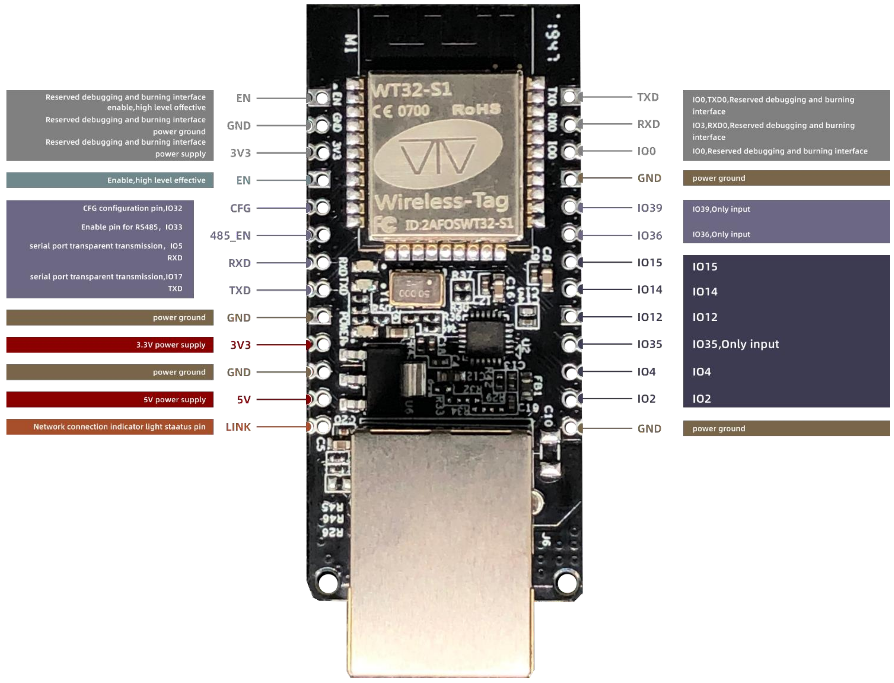

# WT32-ETH01 Gantry Controller

ESP-IDF firmware for the SCHUNK multi-axis gantry pick-and-place motion controller on WT32-ETH01.
Part of the distributed battery sorting cell:
- **Motion Bus (W5500 SPI):** Hard real-time EtherNet/IP Class 1 originator ($2\text{ ms}$ RPI) for Kinetix X/Z and Rexroth Theta drives.
- **Closed Cell Bus (LAN8720 RMII):** High-speed peer-to-peer messaging (CellNet Layer-2 `0x88B5`) connecting Ubuntu Vision, Conveyor WT32, Gantry, and Raspberry Pi Gateway.
- **Diagnostics:** UART0 console + TCP line console (password) on port `2323`.

**Docs:** start with the [Knowledge Transfer page](docs/KNOWLEDGE_TRANSFER.md). Every
document is listed in [`docs/INDEX.md`](docs/INDEX.md), and engineering rules and the
test gate are in [`CONTRIBUTING.md`](CONTRIBUTING.md). Each library under `lib/` has its
own `README.md` and `REFERENCE.md`.

## Console

- **UART0** — flash and pre-link logs (USB–TTL).
- **TCP** on LAN8720 — after plant link is up, gantry listens at
  **`10.42.0.100:2323`**. Password / remember TTL editable under menuconfig
  **TCP gantry console (LAN8720)** (default password `LTU_1932`, 600 s / 4 IPs).

```powershell
ncat 10.42.0.100 2323
# enter password if prompted
# PuTTY: Raw → 10.42.0.100 port 2323
```

```bash
nc 10.42.0.100 2323
```

Details: [LOW_LEVEL §9](docs/LOW_LEVEL_GANTRY_CONTROL.md).

## Build & flash (ESP-IDF)

```powershell
cd idf
idf.py set-target esp32   # first time only
idf.py build
idf.py -p COMx flash monitor
```

Host tests (required before merge):

```powershell
cmake -S test/host -B build/host
cmake --build build/host
ctest --test-dir build/host --output-on-failure
```

See [`CONTRIBUTING.md`](CONTRIBUTING.md).

## Entering programming mode (WT32-ETH01)

You will need a USB–TTL adapter (e.g. Waveshare USB to RS232/RS485/TTL).

1. Power: 5 V to pin 12; GND to board ground and pin 11.
2. UART: adapter RX0 ↔ WT32 TX0; adapter TX0 ↔ WT32 RX0.
3. Boot: jumper pin 24 (IO0) to pin 23 (GND).
4. Reset: briefly ground pin 1 (EN), then remove the IO0 jumper.
5. Flash, then ground EN again to run normally.



## CI

GitHub Actions (`.github/workflows/firmware-ci.yml`) runs host tests and the
ESP-IDF build on push / PR.
