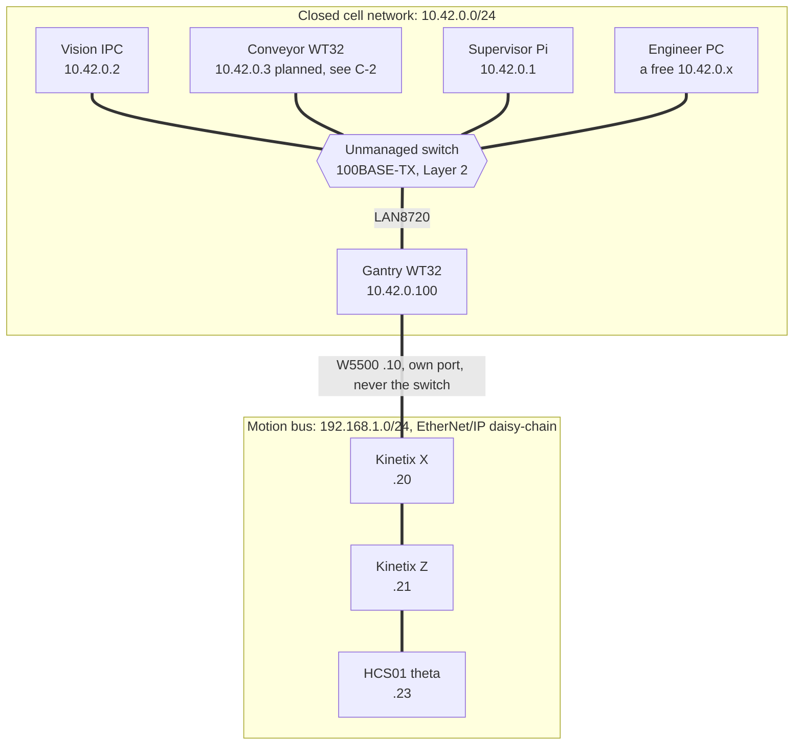
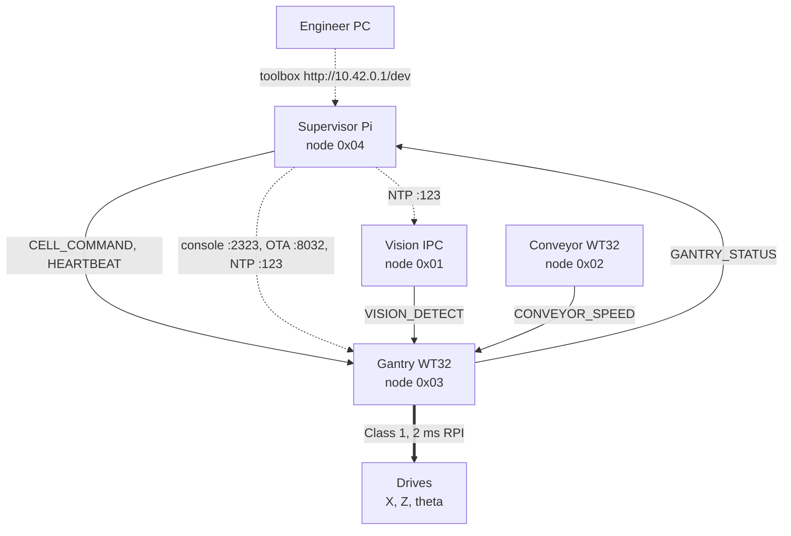

# Knowledge Transfer

**Status:** Living template. Reviewed top to bottom against the code, live logs and project docs on 2026-11-05, at commit `ee99fce`.
**Audience:** Engineers continuing development on the battery sorting cell.
**Companion docs:** [OPEN_ITEMS.md](OPEN_ITEMS.md), [INDEX.md](INDEX.md), [../CONTRIBUTING.md](../CONTRIBUTING.md).

This page is the map, not the manual. It says what each subsystem is, how the pieces connect and where the source lives. Details stay in the canonical docs it links to. What is unfinished lives in one live list, [OPEN_ITEMS.md](OPEN_ITEMS.md).

## How to use and maintain this page

1. Read sections 1 to 4 on day one.
2. Read the section for your subsystem, then its linked docs.
3. Before starting work, read [Blockers and decisions](OPEN_ITEMS.md#blockers-and-decisions) and your subsystem's open items. Update them in the same commit as your change.
4. When a fix teaches a lasting rule, add it to the [working rules](#machine-safety-and-working-rules).

Item IDs such as G-B2 or C-2 refer to [OPEN_ITEMS.md](OPEN_ITEMS.md). Fields marked `TBD` are gaps to fill in. Appendix A has a blank block for adding a component, or a second gantry.

---

## 1. What the cell does

The cell sorts batteries off a moving conveyor. Vision reports where a battery is and what it is, the conveyor reports how far the belt has moved, and the gantry intercepts the battery on the moving belt, grips it and drops it in a bin. The supervisor coordinates and gives engineers a way in.

**Wiring.** Every cell host plugs into one unmanaged switch. The motion bus is a separate daisy-chain on the gantry's own W5500 port.



**Messages.** Solid arrows are CellNet Layer 2 frames (EtherType 0x88B5), dotted arrows are IP services, and the thick arrow is EtherNet/IP Class 1 on the motion bus. All cell traffic crosses the switch above.



**One pick, end to end:**

1. Vision (today, the Gantry team's trigger-sensor workaround) sends `VISION_DETECT` with position, angle, size and class.
2. The gantry places the part on the belt using `CONVEYOR_SPEED` displacement and the configured vision latency.
3. The pick scheduler plans the approach and the strike, and moves to the hover pose.
4. Timers release the Z plunge, fire the grip and start the retract, all timed from the part's arrival.
5. The gantry carries the part to the bin, opens, and returns to staging.

Maths and timing are in [PICK_SCHEDULER_KINEMATICS.md](PICK_SCHEDULER_KINEMATICS.md) and [ON_THE_FLY_PICKUP.md](ON_THE_FLY_PICKUP.md).

## 2. How the subsystems connect

| Link | From → to | Transport | Contract | Failure you will see |
|------|-----------|-----------|----------|----------------------|
| Detections | Vision → gantry, supervisor | CellNet L2 | `L2VisionDetectPayload` | No `vision queued` in the gantry log |
| Belt position | Conveyor → gantry, supervisor | CellNet L2 | `L2ConveyorSpeedPayload` | Picks held, stale belt |
| Commands | Supervisor → gantry | CellNet L2 | `CELL_COMMAND` ids 1 to 6 | No response to START |
| Status | Gantry → supervisor | CellNet L2 | `L2GantryStatusPayload` | `gantry1.online` is false in the supervisor's `/api/state` |
| Console | Supervisor → gantry | TCP `:2323` | Console contract, [LOW_LEVEL §9](LOW_LEVEL_GANTRY_CONTROL.md#9-console-contract) | Console `busy`; send `stop` |
| OTA | Supervisor → gantry | CellNet L2 by default ([CELLNET_OTA_PROTOCOL.md](CELLNET_OTA_PROTOCOL.md)); TCP `:8032` with `?transport=tcp` | `OTA_*` messages, `CELL_COMMAND` 7 | `/api/ota/status` `message`; `emac_missed` must be 0 |
| Motion | Gantry → drives | EtherNet/IP Class 1, 2 ms | Assemblies, [LOW_LEVEL §5](LOW_LEVEL_GANTRY_CONTROL.md#5-class-1-io--wire-format-and-udp-lifecycle) | `E602`, `F4009`, `T->O stale` |
| Time | Supervisor → gantry, vision | NTP | `ntp_server` key | `cfg time` shows `no clock` |

Wire format: [CELL_NET_L2_COMMUNICATION_GUIDE.md](CELL_NET_L2_COMMUNICATION_GUIDE.md). The header is `include/cell_net_l2_protocol.h`, and this repository is its source. The supervisor copies it into its `vendor/cellnet` with its `scripts/sync-cellnet.py`. The conveyor keeps a copy of its own, which has drifted (C-3).

**Direction (decided 2026-11-05):** CellNet L2 is to become the only transport between cell nodes; the OTA and time services above move onto it, OTA first (N-1, N-2). The supervisor web application stays on HTTP, and so does the gantry console on TCP `:2323` (amended 2026-11-15).

**Never connect the motion bus to the cell switch.** [EXPECTED_ELECTROMECHANICAL_ASSEMBLY §3](EXPECTED_ELECTROMECHANICAL_ASSEMBLY.md#3-networks--cell-topology) explains the isolation rule.

## 3. Where everything lives

| Subsystem | Source | Version control | Runs on |
|-----------|--------|-----------------|---------|
| Gantry | This repo | Git, `upstream` = `Mynderse-Research-Lab/wt32-eth01-FreeRTOS` | WT32-ETH01, ESP-IDF v6.0 |
| Conveyor | [wt32-eth01-velmeter](https://github.com/Mynderse-Research-Lab/wt32-eth01-velmeter) | Git, branches `main` and `testing` | WT32-ETH01, ESP-IDF 5.4+ |
| Vision | Computer Science team; repo TBD. Trigger workaround: `~/vision_sim/` on the vision host | **None known**, TBD | Ubuntu 22.04 IPC |
| Supervisor | [ADSB_Sorter-supervisor](https://github.com/Mynderse-Research-Lab/ADSB_Sorter-supervisor), private. Deployed as a copy to `~/ADSB-PI-base` on the Pi | Git. The Pi copy has none; each deploy is logged in the repository's `docs/DEPLOYED_STATE.md` | Raspberry Pi, Debian 13 |
| Production HMI, retired | `D:\Projects\sorting-cell-coordinator` | Git, last commit 2026-08-20 | Never deployed; retired 2026-11-13 with the Zenoh plan (S-5). The supervisor is the HMI |

## 4. First-day setup

Ask the project lead for credentials. **Do not put passwords in docs, scripts or commits.** Tools read `ADSB_DEV_PASS` and `PI_PASS` from the environment.

| Step | Command or place | Done means |
|------|------------------|------------|
| Reach the cell | A cable into the cell switch. The Pi's DHCP leases `10.42.0.50` to `.80`; a static address goes outside that range | Toolbox opens at `http://10.42.0.1/dev` |
| Host tests | `cmake -S test/host -B build/host` then `cmake --build build/host` and `ctest --test-dir build/host --output-on-failure` | All 29 pass; both must pass before a change is final |
| Firmware | `idf.py -C idf build`, target `esp32` | Image builds, from `sdkconfig.defaults` only |
| Read the rules | [Working rules](#machine-safety-and-working-rules) below, and [CONTRIBUTING.md](../CONTRIBUTING.md) | You know what not to do |
| Read the live log | Toolbox log view, or `/dev/log` | You can see `pick actual` lines |

**Windows gotchas:** a fresh host build directory needs `-G "MinGW Makefiles"` on the first `cmake`, otherwise CMake picks NMake and fails. A PowerShell `python` alias can break ESP-IDF's `export.ps1`; run `Remove-Item alias:python` first.

### Machine safety and working rules

| Rule | Why |
|------|-----|
| Send `stop`, then `status`, before every OTA flash | Motors must be off and the gantry idle |
| Test with the 9V cell only | The trigger-sensor workaround sends one fixed frame until the ML model is ready |
| Space vision detections at least 7 s apart in demonstrations | A demonstration control, not a safety measure: it gives the unoptimized planner room to complete each pick. Several detections per second is the goal (G-C10) |
| Gripper regulator at 6 bar | The KGG 100-80 closing time of 0.19 s is specified at 6 bar |
| Eliminate Class 1 drops; never add auto-recovery | A hidden link fault on a motion system is a safety problem |
| Keep core 1 for Class 1; the TFT and other SPI3 work stay on core 0 | With the TFT task on core 1, the reports for two Class 1 gaps of 38 and 46 ms showed it using 39 to 47 ms of core 1, and one gap dropped X (2026-11-03, reverted in `30ac0dd`) |
| Below the scanner's priority, hold the W5500 bus mutex only for a transaction | A statistics read that held it while preempted caused Class 1 gaps of 30 to 90 ms and dropped drives (G-B6) |
| Stored parameters are the only runtime source | Primary objective: avoid NVS read and write delays, so values are loaded once and motion uses RAM. Motion and pick code also never reads a macro for a value with a stored key |
| Pick code never keeps its own copy of a gantry parameter | One unified source of parameters |
| No NVS writes at runtime except `cfg save` | A flash erase outlasts the 32 ms Class 1 timeout |
| Sim gains are not facts | Timing comes from real drive configs or on-system measurement |
| Ask before restarting `adsb-supervisor` | It drops the cell supervisor |
| Keep the TFT enabled | TFT-off runs on 2026-10-20 already ruled SPI3 out as a Class 1 drop cause, so diagnostics work with the display on. GPIO17, the backlight, is not free: only `gripmark` and `vismark` borrow it, and they restore it |

---

## 5. Gantry

Moves the end effector on X, Z and theta, intercepts cells, and drops them in the bin. **There is one gantry today, and more are planned** (see G-A1). Copy this section for each new gantry.

**Read:** [LOW_LEVEL_GANTRY_CONTROL.md](LOW_LEVEL_GANTRY_CONTROL.md), [EXPECTED_ELECTROMECHANICAL_ASSEMBLY.md](EXPECTED_ELECTROMECHANICAL_ASSEMBLY.md), [HV_LV_SCHEMATICS.md](HV_LV_SCHEMATICS.md), `pinout.csv`.

### 5.1 Axes and mechanics

| Axis | Actuator | Drive | Address |
|------|----------|-------|---------|
| X, across belt | SCHUNK Beta 100-ZRS belt | Kinetix 2198-E1020-ERS | `192.168.1.20` |
| Z, +Z down | SCHUNK Beta 80-SRS ballscrew | Kinetix 2198-E1004-ERS | `192.168.1.21` |
| Theta, about Z | SCHUNK ERD 04-40-D-H-N | HCS01.1E-W0005-A-03-B-ET-EC | `192.168.1.23` |

Code: `lib/Gantry`, with drive limits and homing at the drive. Y has no actuator; the belt provides it.

No conveyor-height sensor will be used. The conveyor region is set by parameters (`col_x_min_mm`, `col_z_min_mm`).

**Open items:** [G-A in OPEN_ITEMS.md](OPEN_ITEMS.md#g-a-axes-and-mechanics).

### 5.2 Motion bus (W5500, EtherNet/IP)

WIZ850io on SPI2 runs the originator: Class 1 at a 2 ms RPI, timeout 16 × RPI = 32 ms. Code: `lib/EtherNetIP`, `lib/W5500`. Any stall over 32 ms drops the drives.

**EtherNet/IP background for the items below.** The gantry is the originator and the drives are targets.

| Concept | What it means | On this machine | Source |
|---------|---------------|-----------------|--------|
| Explicit and implicit messaging | Explicit is request/reply over TCP for non-time-critical data. Implicit is real-time I/O over UDP | Cyclic drive I/O is implicit. Forward Open and Close are explicit | [PUB00213](../driver_datasheets_and_calculations/PUB00213R0_EtherNetIP_Developers_Guide.pdf), p. 11, Table 1; [PUB00123](../driver_datasheets_and_calculations/PUB00123R1_Common-Industrial_Protocol_and_Family_of_CIP_Networks.pdf), §3.3.11, p. 70 |
| Encapsulation session | Required before any CIP traffic, and opened with RegisterSession. An originator may register only one active session per TCP connection. A session lasts until either end closes the TCP connection, sends UnRegisterSession, or the connection breaks | `RegisterSession` on each drive, over TCP. A session ends with its TCP connection, so a rebuild opens a new connection and registers again | Vol 2, §2-4.4 pp. 2-13 to 2-15, §2-5.2 to §2-5.4 p. 2-20. [PUB00123](../driver_datasheets_and_calculations/PUB00123R1_Common-Industrial_Protocol_and_Family_of_CIP_Networks.pdf), §3.3.11.2.2, p. 71, says one session between two devices; Vol 2 is the authority |
| Forward Open and Close | Forward Open carries the timeout information and the originator identity. Clean-up happens on a ForwardClose, or when either end times out. A target matches a Forward_Close on Originator Vendor ID, Connection Serial Number and Originator Serial Number, and ignores the path. On EtherNet/IP the sender's IP must also match, or the reply is status 0x0F. Extended status 0x0107 means the connection was not found. A non-null Forward_Open for a connection that still exists returns 0x0100 | A drive that never gets the close times out, which is the G-B1 failure. The session is not part of the match, so closing from a rebuilt session is valid; X and Z accepted it on 2026-10-30 | Vol 1, §3-5.5.3, pp. 3-69 to 3-70, §3-5.5.2, p. 3-68, extended status, p. 3-75; Vol 2, §3-3.10, p. 3-15; PUB00123, §2.3, p. 15; PUB00213, pp. 11, 23 |
| I/O independent of TCP | Forward Open is sent over TCP, but Class 1 shall not depend on that connection and stays up if it closes, until it times out. It is recommended to leave TCP open for the later Forward_Close. If all of a target's CIP connections from an originator time out, the target closes that TCP connection at once | Why Class 1 keeps running after a drive's TCP session has gone (G-B2), and why a Class 1 drop also costs the session | Vol 2, §3-2.2.3, p. 3-7; §2-5.5.2, p. 2-22; PUB00213, p. 39 |
| Class 1 and RPI | The Kinetix is a Class 1 device exchanging data at a Requested Packet Interval. Minimum 2.0 ms, default 20 ms | We run at the minimum, see G-B7 | Kinetix 5100 manual, [2198-UM004D-EN-P](../driver_datasheets_and_calculations/AB_Kinetix5100_user_manual.pdf), pp. 25, 67, 197 |
| Connection timeout | Timeout = RPI × Connection Timeout Multiplier. Value 0 to 7 selects ×4 to ×512, and 8 to 255 are reserved. Only a fresh packet restarts it, and a device stops transmitting once the connection times out. Until the first packet is consumed, the watchdog uses the greater of 10 s and the normal timeout | Why a stall over 32 ms drops a drive: value 2 is ×16, so 32 ms at 2 ms RPI. The 10 s allowance is why the gap from Forward Open to first exchange is harmless | Vol 1, §3-5.5.1.5, Table 3-5.12, p. 3-61; §3-4.5.2, p. 3-34; Vol 2, §3-2.2.2, p. 3-6; `EipScannerPolicy.h:16` |
| Ports | TCP 44818 (0xAF12) for explicit messaging and encapsulation. UDP 2222 (0x08AE) for I/O | Scanner binds UDP 2222 | PUB00123, §3.3.11, p. 70; PUB00213, p. 24 |
| Run/Idle | Class 0 and 1 connections use one of four real-time formats, and the target learns which from the Forward_Open connection path, as its EDS file declares. In the 32-bit header format, bit 0 is 1 for Run and 0 for Idle, and Idle raises an idle event in the target application. What the application does then is vendor-specific, typically a safe state | We use the header with Run always set (`EipCpf.cpp:115`) and never signal Idle. Sending Idle before a close could be tried if theta still latches `F4009` on a clean close (G-B1) | Vol 1, §3-6.1, p. 3-82, §3-6.1.4, Table 3-6.1, p. 3-83; PUB00123, p. 16 and §3.3.12, p. 73; [PUB00070](../driver_datasheets_and_calculations/PUB00070_Recommended-Functionality-for-EIP-Devices-v10.pdf), §5.2 item 3i, p. 10 |
| Encapsulation Inactivity Timeout | TCP/IP Interface object (0xF5) attribute 13, required, settable, stored in non-volatile memory. Default 120 s, range 1 to 3600, 0 disables. With no encapsulation activity for that long, originators and targets shall close the TCP connection. Activity means an encapsulation command sent or received (NOP included), a UCMM request outstanding, or an open Class 2 or 3 connection. Class 1 I/O is not listed, and TCP keep-alive is explicitly excluded. The attribute arrived in object revision 4 | Until the NOP keepalive, nothing went over TCP between Forward Open and Forward Close, so TCP counted as inactive however healthy Class 1 was. This is G-B2. Each axis now reads attribute 13 before Forward Open and logs it. Read on 2026-11-03: X and Z 120 s; theta answers status 0x14 (attribute not supported) | Vol 2, §2-5.5.2, p. 2-21; §5-4.3.2.12, p. 5-20; attribute table, p. 5-12; Table 5-4.1, p. 5-8 |
| NOP | Encapsulation command 0x0000, TCP only. No reply, and no session needed. It counts as activity | Sent on each drive's session at a quarter of its timeout (30 s at the default), from the Class 1 task without waiting for SENDOK (`EipMultiScanner::serviceEncapKeepalive`). Where attribute 13 cannot be read, as on theta, the 120 s default is assumed (`CipTcpIpInterface.cpp`) | Vol 2, Table 2-3.2; §2-4.1, p. 2-9 |
| Class 1 sequence numbers | Start from a random value and add 1 per packet, per connection. A receiver discards a packet at or below the last accepted number, or above it by more than the larger of 16 and the multiplier plus 1. Discarded packets do not keep the connection alive | See G-B8 | Vol 2, §3-4.1, p. 3-16 |
| Device capacity | Recommended, not required: 3 concurrent encapsulation sessions and 3 TCP connections reserved for CIP on any device, and 2 simultaneous Class 1 connections on an adapter | The drives' real limits are not verified | PUB00070, §1.2 p. 1, §2.1 p. 3, §2.2 p. 3, §5.2 p. 9 |
| `E602` | Kinetix fault, control connection lost | Seen on Class 1 loss | Repo only, `KinetixFaultCodes.h`. Not found in the manual's text search |

Vol 1 and Vol 2 above are The CIP Networks Library: Volume 1, Common Industrial Protocol, Edition 3.3, November 2007 (ODVA PUB00001), and Volume 2, EtherNet/IP Adaptation of CIP, Edition 1.18, November 2014 (ODVA PUB00002). They are the authority here, and neither is in this repository. The terms on p. iii of Vol 2 allow one copy on one personal computer and prohibit other electronic copies and postings. Vol 1 is all rights reserved, with permission to reproduce excerpts only from ODVA. The copies cited here came from public archives (archive.org), Vol 2 as OCR text, so confirm anything load-bearing on the drives or against a copy from ODVA.

Both editions are old. Our Vol 1 predates our Vol 2 by seven years, and section numbers have moved: Vol 2 cites the multiplier as §3-5.5.1.6 and Forward_Close as §3-5.5.4, while our Vol 1 has them at §3-5.5.1.5 and §3-5.5.3. [PUB00070](../driver_datasheets_and_calculations/PUB00070_Recommended-Functionality-for-EIP-Devices-v10.pdf) cites Vol 2 Ed. 1.20, so check a newer edition before relying on a detail that may have changed.

The other ODVA documents in `driver_datasheets_and_calculations` are overviews or recommendations, and [PUB00213](../driver_datasheets_and_calculations/PUB00213R0_EtherNetIP_Developers_Guide.pdf) says it does not replace the specification. The Vol 1 and Vol 2 references in `lib/EtherNetIP` comments have been checked against these editions.

**Open items:** [G-B in OPEN_ITEMS.md](OPEN_ITEMS.md#g-b-motion-bus-w5500-ethernetip).

### 5.3 Pick scheduler

Turns detections into timed strikes. Code: `src/pick_scheduler.cpp` and the other `src/pick_*.cpp` files (`pick_scheduler_internal.h` lists them), `include/pick_intercept.h`, `include/strike_plan.h`. Bin drop and traverse run at the safe-Z ceiling: $z_{min}$ plus the stored `geom_safe_z_mm` (48.4 mm by default), applied at boot (`main.cpp:432`).

The model below was read from the code at `ee7b6a7` on 2026-11-05. Each equation names the function that implements it. [PICK_SCHEDULER_KINEMATICS.md](PICK_SCHEDULER_KINEMATICS.md) and [ON_THE_FLY_PICKUP.md](ON_THE_FLY_PICKUP.md) give the derivations and the simulation behind the strike plan. Where they disagree with the code, the code wins (X-2).

**Open items:** [G-C in OPEN_ITEMS.md](OPEN_ITEMS.md#g-c-pick-scheduler).

#### 5.3.1 Frames and symbols

- **Belt plane:** $+X$ across the belt, $+Y$ downstream. Joint Z points down, and $Z = 0$ is fully retracted.
- **Belt:** $s$ is the belt odometer in mm along $+Y$, and $v$ the belt speed.
- **Cell:** a rectangle of length $l$ (the long axis), width $w$ (the side the jaws close across, never larger than $l$) and height $h$ above the belt. Its angle $\theta$ is that of the long axis: $0^\circ$ across the belt, positive toward downstream.
- **Time:** strike times are relative to **arrival**, $t = 0$ when the cell centre reaches the pick plane.
- **Parameters** and their stored keys are in [5.3.10](#5310-parameters).

#### 5.3.2 Belt clock

The conveyor sends frame $k$ every 250 ms with its own timestamp $\tau_k$, displacement $d_k$ and speed $v_k$. The gantry receives it at $r_k$. The clock offset is the smallest delay over the last 8 frames, and the position is extrapolated linearly from the newest frame (`pushMinDelay`, `beltPositionMm`):

$$\delta_k = \min_{j = k-7, \dots, k} (r_j - \tau_j) \tag{1}$$

$$s(t) = d_k + v_k \, (t - \tau_k - \delta_k) \tag{2}$$

- **Stale:** an armed strike aborts when the newest frame is over 500 ms old.
- **Restart:** a sequence jump over 32, a displacement drop over 5 mm, or a timestamp 0.5 s back starts a new epoch. Parts and strikes from the old epoch are dropped.
- **Flat displacement:** if $d$ stays flat for 3 frames while $v > 0$, the position is integrated from $v$, and a bias $b$ keeps it continuous (`anchorFrame`).
- **Assumptions:** $v$ is constant between frames, and the transport delay has a stable minimum that at least one of 8 frames reaches.

#### 5.3.3 From detection to arrival

A `VISION_DETECT` gives $x$ across the belt, $y_{bat}$ from the camera centre, $\theta$, $w$, $l$, $h$ and the class. If $w > l$, the two swap and $\theta$ turns $90^\circ$ (`gripAcrossWidth`). The capture position, the belt position at which the cell reaches the pick plane, and the time left (`capturePositionMm`, `arriveBeltMm`, `secondsToPlane`):

$$s_c = \begin{cases} 1000 \, d_{cap} + b & \text{the frame carries capture displacement} \\ s(r - \Delta_{vis}) & \text{otherwise} \end{cases} \tag{3}$$

$$s_a = s_c + y_{pick} - (y_{cam} + y_{bat}) \tag{4}$$

$$t_a = \frac{s_a - s(t)}{v} \tag{5}$$

- **Latency:** $\Delta_{vis}$ is `vis_lat_ms`. The contract comment says capture displacement is required, but any `vis_lat_ms` above 0 lets every frame use the second line of (3) (G-C13).
- **Trigger stand-in (`vis_batt_x` = 1):** $x$ comes from `batt_x` through forward kinematics, and $y_{bat} = -130 - 6 = -136$ mm, from compile-time constants (G-C5). The frame has no capture displacement, so (3) back-dates the capture by $\Delta_{vis}$. With the compiled defaults, $s_a - s_c$ = 847 mm, which is 2.82 s at 300 mm/s.
- **Gantry X:** the target is the inverse kinematics of $x$ + `vis_x_off_mm`.
- **Repeats:** a detection of the same cell (same id, or within `vis_dedupe_mm` in both $x$ and $s_a$) updates $s_a$. An armed strike then moves only its arrival.
- **Tracking:** up to 16 cells, while $-25 < s_a - s < 1500$ mm.

#### 5.3.4 Grip geometry

The pads run along the long axis and the jaws close across the width (`chooseSideJaw`):

$$\theta_j = \operatorname{fold}(\theta) + \theta_{off} - 90^\circ + k \cdot {180^{\circ}} \tag{6}$$

Here $\operatorname{fold}$ maps an angle into $[-90^\circ, 90^\circ)$, $\theta$ is the vision angle (0° across the belt, 90° along it, positive about +Z up), $\theta_{off}$ is `jaw_off_deg` (0°; joint 0° holds the pads along +Y and a positive joint turns them counter-clockwise seen from above, so joint = pose − 90°), and $k$ picks the in-range joint angle nearest the current one. With $o$ the open jaw gap (`fin_open_mm`) and $z_b$ the joint Z of the belt surface (`col_z_min_mm`):

$$c = \tfrac{1}{2}(o - w) \tag{7}$$

$$z_g = \begin{cases} z_b - 3 & h < 30 \text{ mm} \\ z_b - h + \min(h/2, \, 25.4) & \text{otherwise} \end{cases} \tag{8}$$

$$z_h = \max\big(\min(z_b - h - 6, \; z_{safe}), \; z_{min}\big), \qquad z_{safe} = z_{min} + 48.4 \tag{9}$$

- $c$ is the clearance on each side between the cell and an open pad, which is also each jaw's stroke to contact.
- (8) is `zPlan`.
- (9) is the hover from `StrikePlan::plan`: 6 mm above the cell top, but never lower than the safe-Z ceiling. For a 9V on a belt at Z 122 the ceiling wins, so the plunge starts at $z_{safe}$.

#### 5.3.5 Strike plan

`StrikePlan::plan` (`strike_plan.h`) places three events around arrival: release the plunge, fire the grip valve, start the retract. Move times use the time-optimal trapezoid, or a triangle when the move is too short to reach $v$ (`trapezoidSeconds`):

$$T(D; v, a, d) = \begin{cases} \dfrac{v}{a} + \dfrac{v}{d} + \dfrac{D - D_r}{v} & D \ge D_r = \dfrac{v^2}{2}\left(\dfrac{1}{a} + \dfrac{1}{d}\right) \\[2ex] \hat{v}\left(\dfrac{1}{a} + \dfrac{1}{d}\right), \quad \hat{v} = \sqrt{\dfrac{2Dad}{a + d}} & D < D_r \end{cases} \tag{10}$$

$$\tau_p = T(z_g - z_h; \, v_z, a_z, d_z), \qquad \tau_{band} = \tau_p - \sqrt{2 (z_b - h - z_h) / a_z} \tag{11}$$

- $v_z$ = 0.95 × `z_crit_rpm`/60 × `z_lead_mm`: the ball-screw whip limit less 5 %, 950 mm/s. $a_z$ and $d_z$ are `acc_mm_s2` and `dec_mm_s2`.
- $\tau_{band}$ is the part of the plunge below the cell top. The square root assumes the top is crossed while Z still accelerates; when the top lies past mid-plunge, $\tau_{band}$ comes out too long (G-C6).

The jaw close is a first-order valve lag on a constant jaw speed (`jawStrokeSeconds`):

$$q(t) = v_j \left( t - \tau_v \left(1 - e^{-t/\tau_v}\right) \right), \qquad \tau_{cl} = t_{valve} + q^{-1}(c) \tag{12}$$

Here $v_j$ is `fin_spd_mm_s` (210 mm/s: SCHUNK KGG 100-80, 40 mm in 0.19 s at 6 bar), $\tau_v$ = 15 ms (a simulation constant), and $t_{valve}$ is `pk_von_ms`.

The entry window: the fingertips may pass the cell top only once the cell is 2 mm inside the open gap, and Z must reach depth soon after arrival. $v_\times$ is the belt speed along the close axis:

$$v_\times = v \, |\cos\theta|, \qquad t_{in} = \begin{cases} -(c - 2) / v_\times & v_\times > 1 \text{ mm/s} \\ -0.5 \text{ s} & \text{otherwise} \end{cases} \tag{13}$$

$$t_d = \operatorname{clamp}\Big(\max(t_{in} + 5 \text{ ms}, \; -\tau_{band}) + \tau_{band}, \;\; 0, \;\; \min(15 \text{ ms}, \; 20 \text{ mm} / v)\Big) \tag{14}$$

The events are the nominal times plus the operator offsets:

$$t_z = t_d - \tau_p + \Delta_p, \qquad t_c = t_d - (\tau_{cl} - 8 \text{ ms}) + \Delta_c, \qquad t_r = t_d + \Delta_{r} \tag{15}$$

- **Offsets:** $\Delta_p$, $\Delta_c$, $\Delta_r$ are `pk_off_plunge`, `pk_off_close` and `pk_off_retract`, in whole ms within ±100 ms. Each moves only its own event.
- **Zero offsets:** the retract starts as the plunge ends (zero dwell), and the jaws meet the cell 8 ms after the retract starts.
- **Invariants, applied after the offsets:** $t_r \ge t_z + \tau_p$, so Z never reverses before depth, and $t_z + 2 \text{ ms} \le t_c \le t_r - 2 \text{ ms}$. The dwell $t_r - (t_z + \tau_p)$ is logged with its sign; a negative dwell is not applied.

#### 5.3.6 Feasibility

`evaluate` accepts a strike only when all of these hold:

- **Time:** the pre-position finishes before the plunge release.

  $$\text{slack} = (t_a + t_z) - (T_{app} + 40 \text{ ms} + 30 \text{ ms}) \ge 0 \tag{16}$$

  $T_{app}$ (`budgetPick`) is the move from the current pose to $(x, z_h, \theta_j)$, timed the way the Gantry plans it:
  - X moves only while Z is inside the traverse band.
  - Each segment is a trapezoid (10) plus 40 ms preload and 30 ms settle.
  - A combined X+Z segment is slowed until its Z part stays under $v_z$.
  - Theta runs alongside, starting with the in-band segment after up to 190 ms of start latency.

  The 40 + 30 ms in (16) are the plunge's own preload and settle.
- **Reach:** $z_{min} \le z_g \le \min(\text{Z stroke}, z_b)$, and neither the pick nor the hover pose lies inside the conveyor box, $x \ge$ `col_x_min_mm` with $z > z_b$.
- **Neighbours:** no other tracked cell's bounding box may enter a finger rectangle (`fin_wid_mm` × `fin_len_mm`) from the release at $t_a + t_z$ until Z is back up, $T(z_g - z_h)$ + 70 ms after $t_a + t_r$ (`fingersFreeFromS`).
- **Belt:** $v > 0$ and $t_a > 0$.

#### 5.3.7 Execution and retiming

`runPick` retracts into the band, moves X and theta to the hover pose, and re-evaluates after each move. With the jaw angle then frozen, it preloads the plunge to $z_g$, holds its StartMotion, and arms three one-shot timers at $t_a + t_z$, $t_a + t_c$ and $t_a + t_r$.

Every conveyor frame, and once before each event, re-solves the arrival from (2) and (5). The event offsets stay fixed (`retimeArrival`):

$$t_a \leftarrow t + \frac{s_a - s(t)}{v} \tag{17}$$

- **Abort:** an armed strike aborts on a clock restart, stale frames or a stopped belt.
- **Z event:** releases the preloaded plunge and queues the retract behind it.
- **Grip event:** turns the valve on through the MCP23S17 (PA0).
- **Retract event:** the edge for the queued retract. The drive reverses as the plunge completes.
- **Dispatch:** an event fires when it is due within 1 ms.
- **Log:** `pick actual` gives each event's error against its target and the deepest Z, and warns on a shortfall over 0.3 mm. The drive follows its command about 30–35 ms behind, so a zero-dwell strike reverses about 0.7 mm short of $z_g$ (0.68–0.70 mm on the bench, 5.3.9); that is accepted.

#### 5.3.8 Cycle time and followers

After a strike the gantry carries the cell to the bin. `classifyFollowers` times that cycle and decides how each later cell is approached:

$$T_{cyc} = t_{close} + T_{up} + T_{app}(\text{bin}) + 2 \, T_{bin} + t_{open} \tag{18}$$

$$\text{pace} = \begin{cases} \text{slow} & t_a + T_{cyc} + T_{app}^{slow} \le t_a' \\ \text{fast} & t_a + T_{cyc} + T_{app}^{fast} \le t_a' \\ \text{drop} & \text{otherwise} \end{cases} \tag{19}$$

- $t_{close}$ and $t_{open}$ are `grp_close_ms` and `grp_open_ms` (190 ms each). $T_{up}$ is Z from $z_g$ up to $z_{safe}$; $T_{bin}$ is Z between $z_{safe}$ and the bin, down and back. Each Z move is (10) at $v_z$ plus 70 ms. The bin pose is `geom_cal_x_mm`, `geom_cal_z_mm`, `geom_cal_th_deg`.
- $T_{app}^{slow}$ and $T_{app}^{fast}$ run at `spd_mm_s` and `ceil_spd_mm_s`, from the bin pose to the follower's X and jaw angle. $t_a'$ is the follower's arrival.
- (19) has four known errors (G-C4).

#### 5.3.9 Check against the bench

On 2026-10-25, strikes 7101–7105 picked a 9V on its side with its length along the belt ($\theta = 90^\circ$, $w$ = 17.5, $h$ = 26.5). The inputs were: belt Z 122, so $z_g$ = 119.0; hover 35.7, that day's ceiling; $v_z$ = 950; $a_z = d_z$ = 3000; belt 150 mm/s; offsets 0. The current code, compiled with those inputs, gives:

| Z release to… | Model | Measured ([STRIKE_TIMING](STRIKE_TIMING_MEASUREMENTS_2026-10-25.md)) |
|---|---|---|
| Grip valve fires | +169.5 ms | +169.5 to +170.1 ms (7102–7105); +172.2 ms (7101, whose MCP write took 2.0 ms) |
| Retract commanded | +333.3 ms ($\tau_p$, 83.3 mm triangle) | +333.8 ms (7101) |
| Deepest Z | 119.0 commanded | 118.30–118.32 (the accepted lag) |

At $\theta = 90^\circ$ the belt carries the cell along the pads, so $v_\times = 0$ and (14) gives $t_d = 0$: depth is reached exactly at arrival. Three results from the same code at today's compiled ceiling (48.4), 300 mm/s, 3000 mm/s²:

- **Same cell:** it plunges 70.6 mm in 306.8 ms, and the grip fires 143.0 ms after the release. Computed, not yet measured.
- **Turned across the belt ($\theta = 0^\circ$):** (14) hits its 15 ms cap. On the commanded profile the fingertips pass the cell top 110 ms before arrival, when the cell is still 1.8 mm short of the upstream pad face rather than 2 mm inside it. This holds for $\theta$ from 0° to 35°. The drive's 30–35 ms lag probably hides it on the machine (assumed, G-C11).
- **$\tau_{band}$:** (11) overstates it by 4.4 ms for this cell (8.4 ms at the 35.7 ceiling). That changes the plan only for $\theta$ between 33° and 43° (G-C6).

#### 5.3.10 Parameters

Defaults are the compiled ones; the live stored set differs where noted.

| Symbol | Meaning | Key | Default |
|---|---|---|---|
| $o$ | Open jaw gap | `fin_open_mm` | 80 mm |
| — | Finger thickness and length | `fin_wid_mm`, `fin_len_mm` | 10, 50 mm |
| $v_j$ | Jaw speed | `fin_spd_mm_s` | 210 mm/s |
| $t_{valve}$ | Valve delay | `pk_von_ms` | 8 ms |
| $\Delta_p, \Delta_c, \Delta_r$ | Operator offsets | `pk_off_plunge`, `pk_off_close`, `pk_off_retract` | 0 ms |
| $\theta_{off}$ | Jaw angle offset | `jaw_off_deg` | 0° |
| $z_b$ | Belt surface, joint Z | `col_z_min_mm` | 115 mm (122 live, G-F1) |
| — | Conveyor box edge, X | `col_x_min_mm` | 95 mm |
| $z_{safe} - z_{min}$ | Traverse ceiling | stored `geom_safe_z_mm`, applied at boot | 48.4 mm by default |
| $v_z$ | Plunge speed | 0.95 × `z_crit_rpm`/60 × `z_lead_mm` | 950 mm/s |
| $a_z, d_z$ | Accel, decel (all linear axes) | `acc_mm_s2`, `dec_mm_s2` | 3000 mm/s² (5000 in the 2026-10-30 runs, G-C2) |
| — | Approach speed | `spd_mm_s` | 50 mm/s (750 live, G-C7) |
| — | Fast approach speed | `ceil_spd_mm_s` | 2000 mm/s |
| — | Theta speed, accel, decel | `th_spd_deg_s` (capped by `th_spd_max`), `th_acc_deg_s2`, `th_dec_deg_s2` | 30°/s, 180°/s², 180°/s² |
| $\Delta_{vis}$ | Vision latency | `vis_lat_ms` | 40 ms |
| $y_{cam}, y_{pick}$ | Camera centre, pick plane | `vis_cam_y_mm`, `cv_pick_y_mm` | −711, 0 mm |
| — | Vision X to gantry X | `vis_x_off_mm` | 245 mm (307.5 live, G-F1) |
| — | Duplicate radius | `vis_dedupe_mm` | 40 mm |
| — | Bin pose | `geom_cal_x_mm`, `geom_cal_z_mm`, `geom_cal_th_deg` | 10 mm, 90.8 mm, 90° |
| $t_{close}, t_{open}$ | Grip close and open dwell | `grp_close_ms`, `grp_open_ms` | 190 ms each |
| — | Trigger stand-in | `vis_batt_x`, `batt_x` | 0, 382.5 mm |

Compile-time constants: valve lag $\tau_v$ 15 ms, retract lead 8 ms, hover clearance 6 mm, entry margin 2 mm, entry guard 5 ms, depth cap 15 ms or 20 mm of belt, minimum event gap 2 ms, offset limit ±100 ms (`strike_plan.h`). Grasp rule 3 mm, 30 mm and 25.4 mm (`zPlan`). Frame period 250 ms, stale after 500 ms, 8-frame delay window (`pick_intercept.h`). Trigger geometry −130 and 6 mm (`pick_belt.cpp:15,20`).

#### 5.3.11 Limits of the model

- **Bodies:** rigid rectangles at the reported pose, with no slip on the belt.
- **Belt:** constant speed between 250 ms frames.
- **Open loop:** the plunge is assumed to follow (10) exactly, and the jaw (12) with the simulation's 15 ms valve constant. The real drive lags 30–35 ms. Simulation gains are not facts; the three offsets absorb what the model misses.
- **Provisional constants:** the 6 mm hover clearance, 2 mm entry margin, 5 ms guard, 8 ms retract lead and the 15 ms / 20 mm depth cap are not yet measured.
- **Unused model:** `include/pick_intercept.h` also holds an earlier EarlyZ/LateZ strike model (`planPick`, `strikeLeads`, `retimePick`). Only the host tests call it (G-C8).

### 5.4 Gripper and field I/O

SCHUNK KGG 100-80 pneumatic gripper, driven through an MCP23S17 output (PA0) and a relay-isolated 24 V valve, on SPI3 shared with the TFT. Air regulator at 6 bar. Code: `lib/MCP23S17`, `lib/Spi3Bus`, `GantryEndEffector`.

Two locks guard SPI3: the MCP23S17 mutex, whose waiters give up after 8 ms, and the SPI3 bus mutex, 50 ms. The gripper write, the inputs and the MCP23S17 health check all take the MCP23S17 mutex.

**Open items:** [G-D in OPEN_ITEMS.md](OPEN_ITEMS.md#g-d-gripper-field-io-and-panel).

### 5.5 Controller, cell network and tools

WT32-ETH01 (ESP32) running FreeRTOS at 1000 Hz. LAN8720 carries CellNet, the TCP console and OTA. Code: `src/main.cpp`, `lib/CellNetL2`, `lib/EthernetLink`, `src/gantry_test_console.cpp`, `src/gantry_ota.cpp`. Flash with `python tools/supervisor_ota.py --host 10.42.0.1`, which goes over CellNet L2 by default; add `--transport tcp` for the TCP route.

**Class 1 diagnostics.** `gaptrace` prints the last Class 1 gap of 10 ms or more: where the time went (exchange, receive drain, pace) and the CPU milliseconds of every task, from FreeRTOS run-time stats. Do not trace with a FreeRTOS tick hook: one stalled boot whenever the LAN8720 came up.

**Open items:** [G-E in OPEN_ITEMS.md](OPEN_ITEMS.md#g-e-controller-cell-network-and-tools).

### 5.6 Runtime parameters

One complete set in NVS, loaded at boot. `cfg <key> <value>` changes RAM only; `cfg save` writes NVS. `sdkconfig.defaults` supplies compile-time defaults, used only by keys the set lacks or `cfg factory`. Code: `lib/AppConfig`. Reference: [LOW_LEVEL §14](LOW_LEVEL_GANTRY_CONTROL.md#14-runtime-parameters).

**Open items:** [G-F in OPEN_ITEMS.md](OPEN_ITEMS.md#g-f-runtime-parameters).

---

## 6. Vision

**Owned entirely by the Computer Science team.** Vision finds and classifies cells and sends `VISION_DETECT`.

The ML model is not ready yet. So that development does not stall, the Gantry team uses a workaround: a 1D sensor on the vision PC's Arduino fires one fixed 9V frame, the gantry takes X from `batt_x`, and all testing is 9V only. The workaround is not part of the vision system.

| Component | Detail | Location |
|-----------|--------|----------|
| Vision IPC | Ubuntu 22.04, `enp6s0` at `10.42.0.2`, SSH host alias `sorter`, time from the supervisor | Cell switch |
| Camera and ML model | Pointing down; +Z up, image +X up, +Y left, origin bottom-right, belt moves image-left | Computer Science team; model repo TBD |
| Trigger sensor (Gantry team workaround) | Sharp GP2Y0A21YK0F on an Arduino, 130 mm upstream of camera centre | On the rig |
| Frame sender (Gantry team workaround) | Reads the Arduino over serial and sends the frame | `~/vision_sim/simulate-vision-output.py` |

**Trigger sensor workaround.** Chain latency is set in `vis_lat_ms`, measured with a Saleae capture: about 36 ms with the sensor delay. Rig offsets sit in code (G-C5).

**Read:** [CELL_NET_L2_COMMUNICATION_GUIDE.md](CELL_NET_L2_COMMUNICATION_GUIDE.md).

**Open items:** [V in OPEN_ITEMS.md](OPEN_ITEMS.md#vision).

---

## 7. Conveyor

Carries cells past the gantry and reports belt position. The gantry treats `displacement_m` as the belt position; `speed_mm_s` only projects between samples. Recent running speed is about 290 mm/s.

| Component | Detail | Location |
|-----------|--------|----------|
| Belt and drive | Pot-based motor driver: speed is set by hand, to any value | On the rig |
| Encoder | 500 PPR quadrature (`500 * 4` counts), GPIO36 and GPIO39 | Conveyor WT32 |
| Conveyor node | WT32-ETH01, ESP-IDF, CellNet id `0x02` | [wt32-eth01-velmeter](https://github.com/Mynderse-Research-Lab/wt32-eth01-velmeter) |
| Display | 16x2 I2C LCD, PCF8574 at `0x27` | Conveyor WT32 |
| OTA | HTTP on `:8080`: `tools/ota_update.py <conveyor IP> <app .bin>` from a PC on the cell switch | Conveyor WT32 |

**Read:** that repository's `README.md`, `docs/architecture.md`, `docs/hardware.md`.

**Open items:** [C in OPEN_ITEMS.md](OPEN_ITEMS.md#conveyor).

---

## 8. Supervisor

Raspberry Pi, CellNet node `0x04`. Sends heartbeats and `CELL_COMMAND`, records traffic, runs the dashboard and developer toolbox, relays the gantry console, runs OTA uploads, and serves time.

| Component | Detail | Location |
|-----------|--------|----------|
| Host | Debian 13. `eth0` `10.42.0.1`, Wi-Fi to a hotspot | Pi |
| `adsb-supervisor` | C++ service. Config in `/etc/adsb-cell.env` | Source in the supervisor repository, deployed to `~/ADSB-PI-base/src`; binary `/usr/local/bin` |
| `adsb-cell-dhcp` | DHCP on the cell switch, pool `10.42.0.50` to `.80` | Pi service |
| `chrony` | NTP server for `10.42.0.0/24`; replaced `systemd-timesyncd` on 2026-10-30 | `/etc/chrony/conf.d/gantry-cell.conf` |
| Web UI | `index.html` dashboard, `dev.html` toolbox: console, motion, offsets, parameter download, upload and save, firmware | `/usr/local/share/adsb-cell`, source `~/ADSB-PI-base/web` |

Static web files take effect without a restart. Build the service with `scripts/build.sh`. The repository's `README.md` has the deploy steps; log each deploy in its `docs/DEPLOYED_STATE.md`. The supervisor stays in its own repository, never merged into this one. `D:\Projects\ADSB-PI-base` is an old copy; do not edit it.

**Read:** in the supervisor repository, `README.md`, `docs/NETWORK.md`, `docs/INTEGRATION_WT32.md`, `docs/DEPLOYED_STATE.md`.

**Open items:** [S in OPEN_ITEMS.md](OPEN_ITEMS.md#supervisor).

---

## 9. Repository and documentation

The doc index is [INDEX.md](INDEX.md), and the engineering rules are in [CONTRIBUTING.md](../CONTRIBUTING.md).

**Open items:** [X in OPEN_ITEMS.md](OPEN_ITEMS.md#repository-and-documentation).

---

## Appendix A: Blank component block

Copy this for a new component or a second gantry.

```markdown
### N.N Component name

What it does, in one or two sentences.

| Item | Detail |
|------|--------|
| Hardware | Part numbers |
| Source | Repo, path |
| Interfaces | What it talks to, over what |
| Build / flash | Commands |
| Verify | What healthy looks like |
| Owner | Name |
| Docs | Links |

**Open items:** [P in OPEN_ITEMS.md](OPEN_ITEMS.md#section-anchor).
```

Then give the component an ID prefix and its own section in [OPEN_ITEMS.md](OPEN_ITEMS.md), and point the link above at it.
