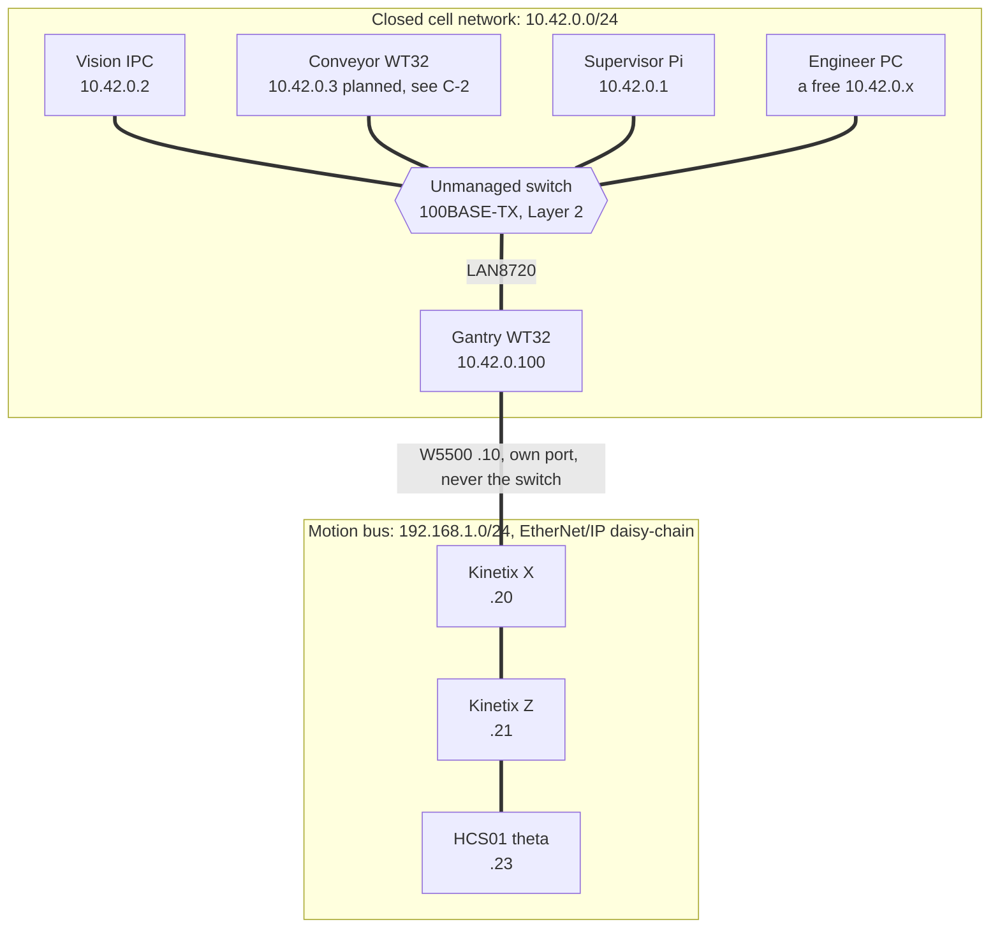
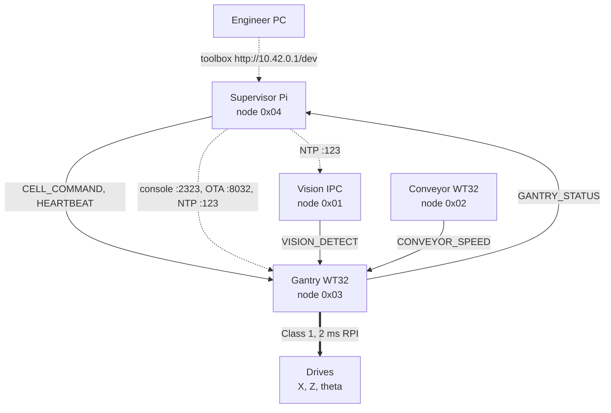

# Knowledge transfer

*[README](/README.md) › Knowledge transfer*

**Read this when** you are new to the cell, or need to know how its subsystems
fit together before going into one of them.

**Status:** Living template. Reviewed top to bottom against the code, live logs
and project docs on 2026-11-05, at commit `8b59545`. **Audience:** Engineers
continuing development on the battery sorting cell. **Companion docs:**
[OPEN_ITEMS.md](OPEN_ITEMS.md), [INDEX.md](INDEX.md),
[CONTRIBUTING.md](/CONTRIBUTING.md).

This page is the map, not the manual. It says what each subsystem is, how the
pieces connect and where the source lives. Details stay in the canonical docs it
links to. What is unfinished lives in one live list,
[OPEN_ITEMS.md](OPEN_ITEMS.md).

## How to use and maintain this page

1.  Read sections 1 to 4 on day one.
2.  Read the section for your subsystem, then follow its **Go deeper** links
    down to the code docs.
3.  Before starting work, read
    [Blockers and decisions](OPEN_ITEMS.md#blockers-and-decisions) and your
    subsystem's open items. Update them in the same commit as your change.
4.  When a fix teaches a lasting rule, add it to the
    [working rules](#machine-safety-and-working-rules).

Item IDs such as G-B2 or C-2 refer to [OPEN_ITEMS.md](OPEN_ITEMS.md). Fields
marked `TBD` are gaps to fill in. Appendix A has a blank block for adding a
component, or a second gantry.

---

## 1. What the cell does

The cell sorts batteries off a moving conveyor. Vision reports where a battery
is and what it is, the conveyor reports how far the belt has moved, and the
gantry intercepts the battery on the moving belt, grips it and drops it in a
bin. The supervisor coordinates and gives engineers a way in.

**Wiring.** Every cell host plugs into one unmanaged switch. The motion bus is a
separate daisy-chain on the gantry's own W5500 port.



**Messages.** Solid arrows are CellNet Layer 2 frames (EtherType 0x88B5), dotted
arrows are IP services, and the thick arrow is EtherNet/IP Class 1 on the motion
bus. All cell traffic crosses the switch above.



**One pick, end to end:**

1.  Vision (today, the Gantry team's trigger-sensor workaround) sends
    `VISION_DETECT` with position, angle, size and class.
2.  The gantry places the part on the belt using `CONVEYOR_SPEED` displacement
    and the configured vision latency.
3.  The pick scheduler plans the approach and the strike, and moves to the hover
    pose.
4.  Timers release the Z plunge, fire the grip and start the retract, all timed
    from the part's arrival.
5.  The gantry carries the part to the bin, opens, and returns to staging.

Maths and timing are in
[PICK_SCHEDULER_KINEMATICS.md](PICK_SCHEDULER_KINEMATICS.md) and
[ON_THE_FLY_PICKUP.md](ON_THE_FLY_PICKUP.md).

## 2. How the subsystems connect

| Link | From → to | Transport | Contract | Failure you will see |
|------|-----------|-----------|----------|----------------------|
| Detections | Vision → gantry, supervisor | CellNet L2 | `L2VisionDetectPayload` | No `vision queued` in the gantry log |
| Belt position | Conveyor → gantry, supervisor | CellNet L2 | `L2ConveyorSpeedPayload` | Picks held, stale belt |
| Commands | Supervisor → gantry | CellNet L2 | `CELL_COMMAND` ids 1 to 6 | No response to START |
| Status | Gantry → supervisor | CellNet L2 | `L2GantryStatusPayload` | `gantry1.online` is false in the supervisor's `/api/state` |
| Console | Supervisor → gantry | TCP `:2323` | Console contract, [GANTRY_FIRMWARE §5](/GANTRY_FIRMWARE.md#5-console-contract) | Console `busy`; send `stop` |
| OTA | Supervisor → gantry | CellNet L2 by default ([CELLNET_OTA_PROTOCOL.md](/lib/CellNetL2/CELLNET_OTA_PROTOCOL.md)); TCP `:8032` with `?transport=tcp` | `OTA_*` messages, `CELL_COMMAND` 7 | `/api/ota/status` `message`; `emac_missed` must be 0 |
| Motion | Gantry → drives | EtherNet/IP Class 1, 2 ms | Assemblies, [Class 1 lifecycle](/lib/EtherNetIP/REFERENCE.md#class-1-lifecycle) | `E602`, `F4009`, `T->O stale` |
| Time | Supervisor → gantry, vision | NTP | `ntp_server` key | `cfg time` shows `no clock` |

Wire format:
[CELL_NET_L2_COMMUNICATION_GUIDE.md](/lib/CellNetL2/CELL_NET_L2_COMMUNICATION_GUIDE.md).
The header is `include/cell_net_l2_protocol.h`, and this repository is its
source. The supervisor copies it into its `vendor/cellnet` with its
`scripts/sync-cellnet.py`. The conveyor keeps a copy of its own, which has
drifted (C-3).

**Direction (decided 2026-11-05):** CellNet L2 is to become the only transport
between cell nodes; the OTA and time services above move onto it, OTA first
(N-1, N-2). The supervisor web application stays on HTTP, and so does the gantry
console on TCP `:2323` (amended 2026-11-15).

**Never connect the motion bus to the cell switch.**
[EXPECTED_ELECTROMECHANICAL_ASSEMBLY §3](EXPECTED_ELECTROMECHANICAL_ASSEMBLY.md#3-networks-and-cell-topology)
explains the isolation rule.

## 3. Where everything lives

| Subsystem | Source | Version control | Runs on |
|-----------|--------|-----------------|---------|
| Gantry | This repo | Git, `upstream` = `Mynderse-Research-Lab/wt32-eth01-FreeRTOS` | WT32-ETH01, ESP-IDF v6.0 |
| Conveyor | [wt32-eth01-velmeter](https://github.com/Mynderse-Research-Lab/wt32-eth01-velmeter) | Git, branches `main` and `testing` | WT32-ETH01, ESP-IDF 5.4+ |
| Vision | Computer Science team; repo TBD. Trigger workaround: `~/vision_sim/` on the vision host | **None known**, TBD | Ubuntu 22.04 IPC |
| Supervisor | [ADSB_Sorter-supervisor](https://github.com/Mynderse-Research-Lab/ADSB_Sorter-supervisor), private. Deployed as a copy to `~/ADSB-PI-base` on the Pi | Git. The Pi copy has none; each deploy is logged in the repository's `docs/DEPLOYED_STATE.md` | Raspberry Pi, Debian 13 |
| Production HMI, retired | `D:\Projects\sorting-cell-coordinator` | Git, last commit 2026-08-20 | Never deployed; retired 2026-11-13 with the Zenoh plan (S-5). The supervisor is the HMI |

## 4. First-day setup

Ask the project lead for credentials. **Do not put passwords in docs, scripts or
commits.** Tools read `ADSB_DEV_PASS` and `PI_PASS` from the environment.

| Step | Command or place | Done means |
|------|------------------|------------|
| Reach the cell | A cable into the cell switch. The Pi's DHCP leases `10.42.0.50` to `.80`; a static address goes outside that range | Toolbox opens at `http://10.42.0.1/dev` |
| Build and test | The quick start in [CONTRIBUTING.md](/CONTRIBUTING.md) | Host tests pass and the image builds |
| Read the rules | [Working rules](#machine-safety-and-working-rules) below, and [CONTRIBUTING.md](/CONTRIBUTING.md) | You know what not to do |
| Read the live log | Toolbox log view, or `/dev/log` | You can see `pick actual` lines |

**Windows gotchas:** a fresh host build directory needs `-G "MinGW Makefiles"`
on the first `cmake`, otherwise CMake picks NMake and fails. A PowerShell
`python` alias can break ESP-IDF's `export.ps1`; run `Remove-Item alias:python`
first.

### Machine safety and working rules

| Rule | Why |
|------|-----|
| Send `stop`, then `status`, before every OTA flash | Motors must be off and the gantry idle |
| Keep the space below Z clear whenever the motors may be disabled | Z has no brake: after `stop`, an OTA flash or a drive fault it can fall to A014 (G-A12). Until G-A13's fix is checked on the cell, bring-up from there needs `calibrate all` twice |
| Test with the 9V cell only | The trigger-sensor workaround sends one fixed frame until the ML model is ready |
| Space vision detections at least 7 s apart in demonstrations | A demonstration control, not a safety measure: it gives the unoptimized planner room to complete each pick. Several detections per second is the goal (G-C10) |
| Gripper regulator at 6 bar | The KGG 100-80 closing time of 0.19 s is specified at 6 bar |
| Eliminate Class 1 drops; never add auto-recovery | A hidden link fault on a motion system is a safety problem |
| Keep core 1 for Class 1; the TFT and other SPI3 work stay on core 0 | With the TFT task on core 1, the reports for two Class 1 gaps of 38 and 46 ms showed it using 39 to 47 ms of core 1, and one gap dropped X (2026-11-03, reverted in `7b325ae`) |
| Below the scanner's priority, hold the W5500 bus mutex only for a transaction | A statistics read that held it while preempted caused Class 1 gaps of 30 to 90 ms and dropped drives (G-B6) |
| Stored parameters are the only runtime source | Primary objective: avoid NVS read and write delays, so values are loaded once and motion uses RAM. Motion and pick code also never reads a macro for a value with a stored key |
| Pick code never keeps its own copy of a gantry parameter | One unified source of parameters |
| No NVS writes at runtime except `cfg save` | A flash erase outlasts the 32 ms Class 1 timeout |
| Sim gains are not facts | Timing comes from real drive configs or on-system measurement |
| Ask before restarting `adsb-supervisor` | It drops the cell supervisor |
| Keep the W5500 SPI bus without DMA (`eip_spi_dma` 0) | With DMA on, a bus capture of 2026-10-21 showed a SEND command going out with stale bytes from the previous DMA buffer, and Class 1 dropped; without DMA a 30 min loaded run was clean. Whether this is a documented ESP32 erratum has not been checked |
| Keep the TFT enabled | TFT-off runs on 2026-10-20 already ruled SPI3 out as a Class 1 drop cause, so diagnostics work with the display on. GPIO17, the backlight, is not free: only `gripmark` and `vismark` borrow it, and they restore it |

---

## 5. Gantry

Moves the end effector on X, Z and theta, intercepts cells, and drops them in
the bin. **There is one gantry today, and more are planned** (see G-A1). Copy
this section for each new gantry.

**Read:** [GANTRY_FIRMWARE.md](/GANTRY_FIRMWARE.md),
[EXPECTED_ELECTROMECHANICAL_ASSEMBLY.md](EXPECTED_ELECTROMECHANICAL_ASSEMBLY.md),
[HV_LV_SCHEMATICS.md](HV_LV_SCHEMATICS.md), `pinout.csv`.

### 5.1 Axes and mechanics

| Axis | Actuator | Drive | Address |
|------|----------|-------|---------|
| X, across belt | SCHUNK Beta 100-ZRS belt | Kinetix 2198-E1020-ERS | `192.168.1.20` |
| Z, +Z down | SCHUNK Beta 80-SRS ballscrew | Kinetix 2198-E1004-ERS | `192.168.1.21` |
| Theta, about Z | SCHUNK ERD 04-40-D-H-N | HCS01.1E-W0005-A-03-B-ET-EC | `192.168.1.23` |

Code: `lib/Gantry`, with drive limits and homing at the drive. Y has no
actuator; the belt provides it.

No conveyor-height sensor will be used. The conveyor region is set by parameters
(`col_x_min_mm`, `col_z_min_mm`).

**Go deeper:**
[EXPECTED_ELECTROMECHANICAL_ASSEMBLY.md](EXPECTED_ELECTROMECHANICAL_ASSEMBLY.md),
the [Gantry library](/lib/Gantry/README.md).

**Open items:** [G-A in OPEN_ITEMS.md](OPEN_ITEMS.md#g-a-axes-and-mechanics).

### 5.2 Motion bus (W5500, EtherNet/IP)

WIZ850io on SPI2 runs the originator: Class 1 at a 2 ms RPI, timeout 16 × RPI =
32 ms. Code: `lib/EtherNetIP`, `lib/W5500`. Any stall over 32 ms drops the
drives.

**EtherNet/IP background for the items below.** The gantry is the originator and
the drives are targets.

| Concept | What it means | On this machine | Source |
|---------|---------------|-----------------|--------|
| Explicit and implicit messaging | Explicit is request/reply over TCP for non-time-critical data. Implicit is real-time I/O over UDP | Cyclic drive I/O is implicit. Forward Open and Close are explicit | PUB00213, p. 11, Table 1; PUB00123, §3.3.11, p. 70 |
| Encapsulation session | Required before any CIP traffic, and opened with RegisterSession. An originator may register only one active session per TCP connection. A session lasts until either end closes the TCP connection, sends UnRegisterSession, or the connection breaks | `RegisterSession` on each drive, over TCP. A session ends with its TCP connection, so a rebuild opens a new connection and registers again | Vol 2, §2-4.4 pp. 2-13 to 2-15, §2-5.2 to §2-5.4 p. 2-20. PUB00123, §3.3.11.2.2, p. 71, says one session between two devices; Vol 2 is the authority |
| Forward Open and Close | Forward Open carries the timeout information and the originator identity. Clean-up happens on a ForwardClose, or when either end times out. A target matches a Forward_Close on Originator Vendor ID, Connection Serial Number and Originator Serial Number, and ignores the path. On EtherNet/IP the sender's IP must also match, or the reply is status 0x0F. Extended status 0x0107 means the connection was not found. A non-null Forward_Open for a connection that still exists returns 0x0100 | A drive that never gets the close times out, which is the G-B1 failure. The session is not part of the match, so closing from a rebuilt session is valid; X and Z accepted it on 2026-10-30 | Vol 1, §3-5.5.3, pp. 3-69 to 3-70, §3-5.5.2, p. 3-68, extended status, p. 3-75; Vol 2, §3-3.10, p. 3-15; PUB00123, §2.3, p. 15; PUB00213, pp. 11, 23 |
| I/O independent of TCP | Forward Open is sent over TCP, but Class 1 shall not depend on that connection and stays up if it closes, until it times out. It is recommended to leave TCP open for the later Forward_Close. If all of a target's CIP connections from an originator time out, the target closes that TCP connection at once | Why Class 1 keeps running after a drive's TCP session has gone (G-B2), and why a Class 1 drop also costs the session | Vol 2, §3-2.2.3, p. 3-7; §2-5.5.2, p. 2-22; PUB00213, p. 39 |
| Class 1 and RPI | The Kinetix is a Class 1 device exchanging data at a Requested Packet Interval. Minimum 2.0 ms, default 20 ms | We run at the minimum, see G-B7 | Kinetix 5100 manual, 2198-UM004D-EN-P, pp. 25, 67, 197 |
| Connection timeout | Timeout = RPI × Connection Timeout Multiplier. Value 0 to 7 selects ×4 to ×512, and 8 to 255 are reserved. Only a fresh packet restarts it, and a device stops transmitting once the connection times out. Until the first packet is consumed, the watchdog uses the greater of 10 s and the normal timeout | Why a stall over 32 ms drops a drive: value 2 is ×16, so 32 ms at 2 ms RPI. The 10 s allowance is why the gap from Forward Open to first exchange is harmless | Vol 1, §3-5.5.1.5, Table 3-5.12, p. 3-61; §3-4.5.2, p. 3-34; Vol 2, §3-2.2.2, p. 3-6; `EipScannerPolicy.h:16` |
| Ports | TCP 44818 (0xAF12) for explicit messaging and encapsulation. UDP 2222 (0x08AE) for I/O | Scanner binds UDP 2222 | PUB00123, §3.3.11, p. 70; PUB00213, p. 24 |
| Run/Idle | Class 0 and 1 connections use one of four real-time formats, and the target learns which from the Forward_Open connection path, as its EDS file declares. In the 32-bit header format, bit 0 is 1 for Run and 0 for Idle, and Idle raises an idle event in the target application. What the application does then is vendor-specific, typically a safe state | We use the header with Run always set (`EipCpf.cpp:115`) and never signal Idle. Sending Idle before a close could be tried if theta still latches `F4009` on a clean close (G-B1) | Vol 1, §3-6.1, p. 3-82, §3-6.1.4, Table 3-6.1, p. 3-83; PUB00123, p. 16 and §3.3.12, p. 73; PUB00070, §5.2 item 3i, p. 10 |
| Encapsulation Inactivity Timeout | TCP/IP Interface object (0xF5) attribute 13, required, settable, stored in non-volatile memory. Default 120 s, range 1 to 3600, 0 disables. With no encapsulation activity for that long, originators and targets shall close the TCP connection. Activity means an encapsulation command sent or received (NOP included), a UCMM request outstanding, or an open Class 2 or 3 connection. Class 1 I/O is not listed, and TCP keep-alive is explicitly excluded. The attribute arrived in object revision 4 | Until the NOP keepalive, nothing went over TCP between Forward Open and Forward Close, so TCP counted as inactive however healthy Class 1 was. This is G-B2. Each axis now reads attribute 13 before Forward Open and logs it. Read on 2026-11-03: X and Z 120 s; theta answers status 0x14 (attribute not supported) | Vol 2, §2-5.5.2, p. 2-21; §5-4.3.2.12, p. 5-20; attribute table, p. 5-12; Table 5-4.1, p. 5-8 |
| NOP | Encapsulation command 0x0000, TCP only. No reply, and no session needed. It counts as activity | Sent on each drive's session at a quarter of its timeout (30 s at the default), from the Class 1 task without waiting for SENDOK (`EipMultiScanner::serviceEncapKeepalive`). Where attribute 13 cannot be read, as on theta, the 120 s default is assumed (`CipTcpIpInterface.cpp`) | Vol 2, Table 2-3.2; §2-4.1, p. 2-9 |
| Class 1 sequence numbers | Start from a random value and add 1 per packet, per connection. A receiver discards a packet at or below the last accepted number, or above it by more than the larger of 16 and the multiplier plus 1. Discarded packets do not keep the connection alive | See G-B8 | Vol 2, §3-4.1, p. 3-16 |
| Device capacity | Recommended, not required: 3 concurrent encapsulation sessions and 3 TCP connections reserved for CIP on any device, and 2 simultaneous Class 1 connections on an adapter | The drives' real limits are not verified | PUB00070, §1.2 p. 1, §2.1 p. 3, §2.2 p. 3, §5.2 p. 9 |
| `E602` | Kinetix fault, control connection lost | Seen on Class 1 loss | Repo only, `KinetixFaultCodes.h`. Not found in the manual's text search |

Vol 1 and Vol 2 above are The CIP Networks Library: Volume 1, Common Industrial
Protocol, Edition 3.3, November 2007 (ODVA PUB00001), and Volume 2, EtherNet/IP
Adaptation of CIP, Edition 1.18, November 2014 (ODVA PUB00002). They are the
authority here, and neither is in this repository. The terms on p. iii of Vol 2
allow one copy on one personal computer and prohibit other electronic copies and
postings. Vol 1 is all rights reserved, with permission to reproduce excerpts
only from ODVA. The copies cited here came from public archives (archive.org),
Vol 2 as OCR text, so confirm anything load-bearing on the drives or against a
copy from ODVA.

Both editions are old. Our Vol 1 predates our Vol 2 by seven years, and section
numbers have moved: Vol 2 cites the multiplier as §3-5.5.1.6 and Forward_Close
as §3-5.5.4, while our Vol 1 has them at §3-5.5.1.5 and §3-5.5.3. PUB00070 cites
Vol 2 Ed. 1.20, so check a newer edition before relying on a detail that may
have changed.

The other ODVA documents in the
[vendor catalog](/driver_datasheets_and_calculations/INDEX.md) are overviews or
recommendations, and PUB00213 says it does not replace the specification. The
Vol 1 and Vol 2 references in `lib/EtherNetIP` comments have been checked
against these editions.

**Go deeper:** [GANTRY_FIRMWARE §4](/GANTRY_FIRMWARE.md#4-one-move-end-to-end),
the [EtherNetIP](/lib/EtherNetIP/README.md) and [W5500](/lib/W5500/README.md)
libraries.

**Open items:**
[G-B in OPEN_ITEMS.md](OPEN_ITEMS.md#g-b-motion-bus-w5500-ethernetip).

### 5.3 Pick scheduler

Turns detections into timed strikes. Code: `src/pick_scheduler.cpp` and the
other `src/pick_*.cpp` files (`pick_scheduler_internal.h` lists them),
`include/pick_intercept.h`, `include/strike_plan.h`. Bin drop and traverse run
at the safe-Z ceiling: $z_{min}$ plus the stored `geom_safe_z_mm` (48.4 mm by
default), applied at boot (`main_init_motion.cpp:163`).

The pick model, read from the code, is in
[GANTRY_FIRMWARE §6](/GANTRY_FIRMWARE.md#pick-model-until-the-math-document)
until the math document replaces it.

**Go deeper:** [GANTRY_FIRMWARE §6](/GANTRY_FIRMWARE.md#6-the-pick-path).

**Open items:** [G-C in OPEN_ITEMS.md](OPEN_ITEMS.md#g-c-pick-scheduler).

### 5.4 Gripper and field I/O

SCHUNK KGG 100-80 pneumatic gripper, driven through an MCP23S17 output (PA0) and
a relay-isolated 24 V valve, on SPI3 shared with the TFT. Air regulator at 6
bar. Code: `lib/MCP23S17`, `lib/Spi3Bus`, `GantryEndEffector`.

Two locks guard SPI3: the MCP23S17 mutex, whose waiters give up after 8 ms, and
the SPI3 bus mutex, 50 ms. The gripper write, the inputs and the MCP23S17 health
check all take the MCP23S17 mutex.

**Go deeper:** the [GpioExpander](/lib/GpioExpander/README.md) and
[MCP23S17](/lib/MCP23S17/README.md) libraries,
[HV_LV_SCHEMATICS.md](HV_LV_SCHEMATICS.md).

**Open items:**
[G-D in OPEN_ITEMS.md](OPEN_ITEMS.md#g-d-gripper-field-io-and-panel).

### 5.5 Controller, cell network and tools

WT32-ETH01 (ESP32) running FreeRTOS at 1000 Hz. LAN8720 carries CellNet, the TCP
console and OTA. Code: `src/main.cpp`, `lib/CellNetL2`, `lib/EthernetLink`,
`src/gantry_test_console.cpp`, `lib/GantryOta`. Flash with
`python tools/supervisor_ota.py --host 10.42.0.1`, which goes over CellNet L2 by
default; add `--transport tcp` for the TCP route.

**Class 1 diagnostics.** `gaptrace` prints the last Class 1 gap of 10 ms or
more: where the time went (exchange, receive drain, pace) and the CPU
milliseconds of every task, from FreeRTOS run-time stats. Do not trace with a
FreeRTOS tick hook: one stalled boot whenever the LAN8720 came up.

**Go deeper:** [GANTRY_FIRMWARE.md](/GANTRY_FIRMWARE.md), the
[EthernetLink](/lib/EthernetLink/README.md) and
[CellNetL2](/lib/CellNetL2/README.md) libraries,
[tools/README.md](/tools/README.md).

**Open items:**
[G-E in OPEN_ITEMS.md](OPEN_ITEMS.md#g-e-controller-cell-network-and-tools).

### 5.6 Runtime parameters

One complete set in NVS, loaded at boot. `cfg <key> <value>` changes RAM only;
`cfg save` writes NVS. `sdkconfig.defaults` supplies compile-time defaults, used
only by keys the set lacks or `cfg factory`. Code: `lib/AppConfig`. Reference:
[GANTRY_FIRMWARE §14](/GANTRY_FIRMWARE.md#7-runtime-parameters).

**Go deeper:** [GANTRY_FIRMWARE §7](/GANTRY_FIRMWARE.md#7-runtime-parameters),
the [AppConfig library](/lib/AppConfig/README.md).

**Open items:** [G-F in OPEN_ITEMS.md](OPEN_ITEMS.md#g-f-runtime-parameters).

---

## 6. Vision

**Owned entirely by the Computer Science team.** Vision finds and classifies
cells and sends `VISION_DETECT`.

The ML model is not ready yet. So that development does not stall, the Gantry
team uses a workaround: a 1D sensor on the vision PC's Arduino fires one fixed
9V frame, the gantry takes X from `batt_x`, and all testing is 9V only. The
workaround is not part of the vision system.

| Component | Detail | Location |
|-----------|--------|----------|
| Vision IPC | Ubuntu 22.04, `enp6s0` at `10.42.0.2`, SSH host alias `sorter`, time from the supervisor | Cell switch |
| Camera and ML model | Pointing down; +Z up, image +X up, +Y left, origin bottom-right, belt moves image-left | Computer Science team; model repo TBD |
| Trigger sensor (Gantry team workaround) | Sharp GP2Y0A21YK0F on an Arduino, 130 mm upstream of camera centre | On the rig |
| Frame sender (Gantry team workaround) | Reads the Arduino over serial and sends the frame | `~/vision_sim/simulate-vision-output.py` |

**Trigger sensor workaround.** Chain latency is set in `vis_lat_ms`, measured
with a Saleae capture: about 36 ms with the sensor delay. Rig offsets sit in
code (G-C5).

**Read:**
[CELL_NET_L2_COMMUNICATION_GUIDE.md](/lib/CellNetL2/CELL_NET_L2_COMMUNICATION_GUIDE.md).

**Open items:** [V in OPEN_ITEMS.md](OPEN_ITEMS.md#vision).

---

## 7. Conveyor

Carries cells past the gantry and reports belt position. The gantry treats
`displacement_m` as the belt position; `speed_mm_s` only projects between
samples. Recent running speed is about 290 mm/s.

| Component | Detail | Location |
|-----------|--------|----------|
| Belt and drive | Pot-based motor driver: speed is set by hand, to any value | On the rig |
| Encoder | 500 PPR quadrature (`500 * 4` counts), GPIO36 and GPIO39 | Conveyor WT32 |
| Conveyor node | WT32-ETH01, ESP-IDF, CellNet id `0x02` | [wt32-eth01-velmeter](https://github.com/Mynderse-Research-Lab/wt32-eth01-velmeter) |
| Display | 16x2 I2C LCD, PCF8574 at `0x27` | Conveyor WT32 |
| OTA | HTTP on `:8080`: `tools/ota_update.py <conveyor IP> <app .bin>` from a PC on the cell switch | Conveyor WT32 |

**Read:** that repository's `README.md`, `docs/architecture.md`,
`docs/hardware.md`.

**Open items:** [C in OPEN_ITEMS.md](OPEN_ITEMS.md#conveyor).

---

## 8. Supervisor

Raspberry Pi, CellNet node `0x04`. Sends heartbeats and `CELL_COMMAND`, records
traffic, runs the dashboard and developer toolbox, relays the gantry console,
runs OTA uploads, and serves time.

| Component | Detail | Location |
|-----------|--------|----------|
| Host | Debian 13. `eth0` `10.42.0.1`, Wi-Fi to a hotspot | Pi |
| `adsb-supervisor` | C++ service. Config in `/etc/adsb-cell.env` | Source in the supervisor repository, deployed to `~/ADSB-PI-base/src`; binary `/usr/local/bin` |
| `adsb-cell-dhcp` | DHCP on the cell switch, pool `10.42.0.50` to `.80` | Pi service |
| `chrony` | NTP server for `10.42.0.0/24`; replaced `systemd-timesyncd` on 2026-10-30 | `/etc/chrony/conf.d/gantry-cell.conf` |
| Web UI | `index.html` dashboard, `dev.html` toolbox: console, motion, offsets, parameter download, upload and save, firmware | `/usr/local/share/adsb-cell`, source `~/ADSB-PI-base/web` |

Static web files take effect without a restart. Build the service with
`scripts/build.sh`. The repository's `README.md` has the deploy steps; log each
deploy in its `docs/DEPLOYED_STATE.md`. The supervisor stays in its own
repository, never merged into this one. `D:\Projects\ADSB-PI-base` is an old
copy; do not edit it.

**Read:** in the supervisor repository, `README.md`, `docs/NETWORK.md`,
`docs/INTEGRATION_WT32.md`, `docs/DEPLOYED_STATE.md`.

**Open items:** [S in OPEN_ITEMS.md](OPEN_ITEMS.md#supervisor).

---

## 9. Repository and documentation

The reading path runs from the [README](/README.md) through this page to
[GANTRY_FIRMWARE.md](/GANTRY_FIRMWARE.md), [lib/README.md](/lib/README.md) and
each library's README and REFERENCE. The doc index is [INDEX.md](INDEX.md), and
the engineering rules are in [CONTRIBUTING.md](/CONTRIBUTING.md).

**Open items:**
[X in OPEN_ITEMS.md](OPEN_ITEMS.md#repository-and-documentation).

---

## Appendix A: Blank component block

Copy this for a new component or a second gantry.

```markdown
### N.N Component name

What it does, in one or two sentences.

| Item | Detail |
|------|--------|
| Hardware | Part numbers |
| Source | Repo, path |
| Interfaces | What it talks to, over what |
| Build / flash | Commands |
| Verify | What healthy looks like |
| Owner | Name |
| Docs | Links |

**Open items:** [P in OPEN_ITEMS.md](OPEN_ITEMS.md#section-anchor).
```

Then give the component an ID prefix and its own section in
[OPEN_ITEMS.md](OPEN_ITEMS.md), and point the link above at it.

## See also

-   **Down:** [GANTRY_FIRMWARE.md](/GANTRY_FIRMWARE.md), how the gantry firmware
    works.
-   **Up:** [README](/README.md).
-   **Also:** [open items](OPEN_ITEMS.md), [contributing](/CONTRIBUTING.md),
    [doc index](INDEX.md).
