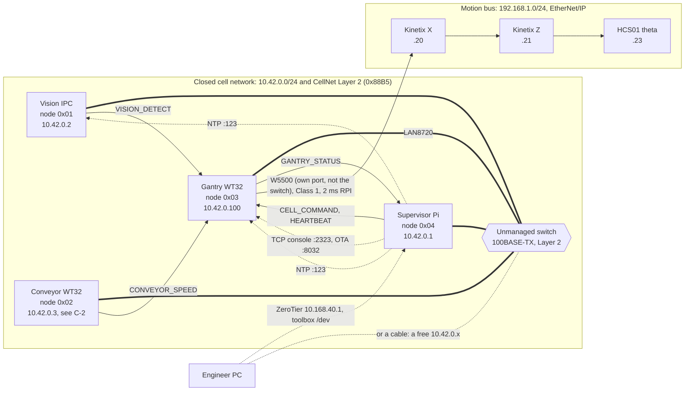

# Knowledge Transfer

**Status:** Living template. Filled in from the code, live logs and project docs, last checked 2026-10-30 at commit `d6e8f8e`.
**Audience:** Engineers continuing development on the battery sorting cell.
**Companion docs:** [INDEX.md](INDEX.md), [../CONTRIBUTING.md](../CONTRIBUTING.md).

This page is the map, not the manual. It says what each subsystem is, how the pieces connect, where the source lives, and what is unfinished. Details stay in the canonical docs it links to.

## How to use and maintain this page

1. Read sections 1 to 4 on day one.
2. Read the section for your subsystem, then its linked docs.
3. Check the open items under each component before starting work, and update them when you finish.

Fields marked `TBD` are gaps to fill in. Appendix A has a blank block for adding a component, or a second gantry.

Every open item carries an evidence label. **Do not treat a label lower than Confirmed as fact.**

| Label | Meaning |
|-------|---------|
| **Confirmed** | Checked against code, a live log or a measurement. |
| **Suggested** | From an AI-generated plan and not yet checked. Treat it as a lead. |
| **Decision** | Needs a call from the project lead before anyone starts. |

Items with `(plan)` also appear in the plans listed in [Appendix B](#appendix-b-suggested-plans-since-2026-10-29).

---

## 1. What the cell does

The cell sorts batteries off a moving conveyor. Vision reports where a battery is and what it is, the conveyor reports how far the belt has moved, and the gantry intercepts the battery on the moving belt, grips it and drops it in a bin. The supervisor coordinates and gives engineers a way in.

Thick lines are cables. Arrows are messages, which all cross the switch.



**One pick, end to end:**

1. Vision (today, the Gantry team's trigger-sensor workaround) sends `VISION_DETECT` with position, angle, size and class.
2. The gantry places the part on the belt using `CONVEYOR_SPEED` displacement and the configured vision latency.
3. The pick scheduler plans the approach and the strike, and moves to the hover pose.
4. Timers release the Z plunge, fire the grip and start the retract, all timed from the part's arrival.
5. The gantry carries the part to the bin, opens, and returns to staging.

Maths and timing are in [PICK_SCHEDULER_KINEMATICS.md](PICK_SCHEDULER_KINEMATICS.md) and [ON_THE_FLY_PICKUP.md](ON_THE_FLY_PICKUP.md).

## 2. How the subsystems connect

| Link | From → to | Transport | Contract | Failure you will see |
|------|-----------|-----------|----------|----------------------|
| Detections | Vision → gantry, supervisor | CellNet L2 | `L2VisionDetectPayload` | No `vision queued` in the gantry log |
| Belt position | Conveyor → gantry, supervisor | CellNet L2 | `L2ConveyorSpeedPayload` | Picks held, stale belt |
| Commands | Supervisor → gantry | CellNet L2 | `CELL_COMMAND` ids 1 to 6 | No response to START |
| Status | Gantry → supervisor | CellNet L2 | `L2GantryStatusPayload` | `gantry1 online:false` |
| Console, OTA | Supervisor → gantry | TCP `:2323`, `:8032` | Console contract, [LOW_LEVEL §9](LOW_LEVEL_GANTRY_CONTROL.md#9-console-contract) | Console `busy`; send `stop` |
| Motion | Gantry → drives | EtherNet/IP Class 1, 2 ms | Assemblies, [LOW_LEVEL §5](LOW_LEVEL_GANTRY_CONTROL.md#5-class-1-io--wire-format-and-udp-lifecycle) | `E602`, `F4009`, `T->O stale` |
| Time | Supervisor → gantry, vision | NTP | `ntp_server` key | `cfg time` shows `no clock` |

Wire format: [CELL_NET_L2_COMMUNICATION_GUIDE.md](CELL_NET_L2_COMMUNICATION_GUIDE.md). The header is `include/cell_net_l2_protocol.h`, with copies in the conveyor and supervisor projects (see X-3).

**Never connect the motion bus to the cell switch.** [EXPECTED_ELECTROMECHANICAL_ASSEMBLY §3](EXPECTED_ELECTROMECHANICAL_ASSEMBLY.md#3-networks--cell-topology) explains the isolation rule.

## 3. Where everything lives

| Subsystem | Source | Version control | Runs on |
|-----------|--------|-----------------|---------|
| Gantry | This repo | Git, `upstream` = `Mynderse-Research-Lab/wt32-eth01-FreeRTOS` | WT32-ETH01, ESP-IDF v6.0 |
| Conveyor | [wt32-eth01-velmeter](https://github.com/Mynderse-Research-Lab/wt32-eth01-velmeter) | Git, branches `main` and `testing` | WT32-ETH01, ESP-IDF 5.4+ |
| Vision | Computer Science team; repo TBD. Trigger workaround: `~/vision_sim/` on the vision host | **None known**, TBD | Ubuntu 22.04 IPC |
| Supervisor | `~/ADSB-PI-base` on the Pi | **None on the Pi** (see S-1) | Raspberry Pi, Debian 13 |
| Production HMI, planned | `D:\Projects\sorting-cell-coordinator` | Git, last commit 2026-08-20 | Not deployed, see S-5 |

## 4. First-day setup

Ask the project lead for credentials. **Do not put passwords in docs, scripts or commits.** Tools read `ADSB_DEV_PASS` and `PI_PASS` from the environment.

| Step | Command or place | Done means |
|------|------------------|------------|
| Reach the cell | ZeroTier to `10.168.40.1`, or a free address on `10.42.0.0/24` | Toolbox opens at `http://10.168.40.1/dev` |
| Host tests | `cmake -S test/host -B build/host` then `cmake --build build/host` and `ctest --test-dir build/host --output-on-failure` | 28 of 28 pass; both must pass before a change is final |
| Firmware | `idf.py -C idf build`, target `esp32` | Image builds, from `sdkconfig.defaults` only |
| Read the rules | [Working rules](#machine-safety-and-working-rules) below, and [CONTRIBUTING.md](../CONTRIBUTING.md) | You know what not to do |
| Read the live log | Toolbox log view, or `/dev/log` | You can see `pick actual` lines |

**Windows gotchas:** a fresh host build directory needs `-G "MinGW Makefiles"` on the first `cmake`, otherwise CMake picks NMake and fails. A PowerShell `python` alias can break ESP-IDF's `export.ps1`; run `Remove-Item alias:python` first.

### Machine safety and working rules

| Rule | Why |
|------|-----|
| Send `stop`, then `status`, before every OTA flash | Motors must be off and the gantry idle |
| Test with the 9V cell only | The trigger-sensor workaround sends one fixed frame until the ML model is ready |
| Space vision detections at least 7 s apart in demonstrations | A demonstration control, not a safety measure: it gives the unoptimized planner room to complete each pick. Several detections per second is the goal (G-C10) |
| Gripper regulator at 6 bar | The KGG 100-80 closing time of 0.19 s is specified at 6 bar |
| Eliminate Class 1 drops; never add auto-recovery | A hidden link fault on a motion system is a safety problem |
| Stored parameters are the only runtime source | Primary objective: avoid NVS read and write delays, so values are loaded once and motion uses RAM. Motion and pick code also never reads a macro for a value with a stored key |
| Pick code never keeps its own copy of a gantry parameter | One unified source of parameters |
| No NVS writes at runtime except `cfg save` | A flash erase outlasts the 32 ms Class 1 timeout |
| Sim gains are not facts | Timing comes from real drive configs or on-system measurement |
| Ask before restarting `adsb-supervisor` | It drops the cell supervisor |
| Keep the TFT enabled | GPIO17 can be used temporarily for experiments, but it is not free and must be reverted to its role |

---

## 5. Gantry

Moves the end effector on X, Z and theta, intercepts cells, and drops them in the bin. **There is one gantry today, and more are planned** (see G-A1). Copy this section for each new gantry.

**Read:** [LOW_LEVEL_GANTRY_CONTROL.md](LOW_LEVEL_GANTRY_CONTROL.md), [EXPECTED_ELECTROMECHANICAL_ASSEMBLY.md](EXPECTED_ELECTROMECHANICAL_ASSEMBLY.md), [HV_LV_SCHEMATICS.md](HV_LV_SCHEMATICS.md), `pinout.csv`.

### 5.1 Axes and mechanics

| Axis | Actuator | Drive | Address |
|------|----------|-------|---------|
| X, across belt | SCHUNK Beta 100-ZRS belt | Kinetix 2198-E1020-ERS | `192.168.1.20` |
| Z, +Z down | SCHUNK Beta 80-SRS ballscrew | Kinetix 2198-E1004-ERS | `192.168.1.21` |
| Theta, about Z | SCHUNK ERD 04-40-D-H-N | HCS01.1E-W0005-A-03-B-ET-EC | `192.168.1.23` |

Code: `lib/Gantry`, with drive limits and homing at the drive. Y has no actuator; the belt provides it.

No conveyor-height sensor will be used. The conveyor region is set by parameters (`col_x_min_mm`, `col_z_min_mm`).

**Open items and blockers**

| ID | Item | Evidence | Next step |
|----|------|----------|-----------|
| G-A1 | Multiple gantries are planned. Preferred: one gantry manages 2 classes, dropping one class left and the other right. Fallback: one gantry for each class (9V, laptop, li-ion pack, powertool battery) | Confirmed plan. Not supported yet: one `GANTRY` node id, one `gantry1` status field, one bin pose | Add node ids and per-class drop poses; start with two-sided drop |
| G-A2 | Z continuous torque is about 0.95× the SCHUNK 1.35 N·m requirement | Confirmed in [DEV_TRACKER](DEV_TRACKER.md), not re-measured | Review before production duty |
| G-A4 | Why Z reads about −42 instead of 48 after a reboot, before `calibrate all` | Confirmed reading; a physical drop was not ruled out | Observe Z across a reboot |

### 5.2 Motion bus (W5500, EtherNet/IP)

WIZ850io on SPI2 runs the originator: Class 1 at a 2 ms RPI, timeout 16 × RPI = 32 ms. Code: `lib/EtherNetIP`, `lib/W5500`. Any stall over 32 ms drops the drives.

**EtherNet/IP background for the items below.** The gantry is the originator and the drives are targets.

| Concept | What it means | On this machine | Source |
|---------|---------------|-----------------|--------|
| Explicit and implicit messaging | Explicit is request/reply over TCP for non-time-critical data. Implicit is real-time I/O over UDP | Cyclic drive I/O is implicit. Forward Open and Close are explicit | [PUB00213](../driver_datasheets_and_calculations/PUB00213R0_EtherNetIP_Developers_Guide.pdf), p. 11, Table 1; [PUB00123](../driver_datasheets_and_calculations/PUB00123R1_Common-Industrial_Protocol_and_Family_of_CIP_Networks.pdf), §3.3.11, p. 70 |
| Encapsulation session | Required before any CIP traffic, and opened with RegisterSession. An originator may register only one active session per TCP connection. A session lasts until either end closes the TCP connection, sends UnRegisterSession, or the connection breaks | `RegisterSession` on each drive, over TCP. A session ends with its TCP connection, so a rebuild opens a new connection and registers again | Vol 2, §2-4.4 pp. 2-13 to 2-15, §2-5.2 to §2-5.4 p. 2-20. [PUB00123](../driver_datasheets_and_calculations/PUB00123R1_Common-Industrial_Protocol_and_Family_of_CIP_Networks.pdf), §3.3.11.2.2, p. 71, says one session between two devices; Vol 2 is the authority |
| Forward Open and Close | Forward Open carries the timeout information and the originator identity. Clean-up happens on a ForwardClose, or when either end times out. A target matches a Forward_Close on Originator Vendor ID, Connection Serial Number and Originator Serial Number, and ignores the path. On EtherNet/IP the sender's IP must also match, or the reply is status 0x0F. Extended status 0x0107 means the connection was not found. A non-null Forward_Open for a connection that still exists returns 0x0100 | A drive that never gets the close times out, which is the G-B1 failure. The session is not part of the match, so closing from a rebuilt session is valid; X and Z accepted it on 2026-10-30 | Vol 1, §3-5.5.3, pp. 3-69 to 3-70, §3-5.5.2, p. 3-68, extended status, p. 3-75; Vol 2, §3-3.10, p. 3-15; PUB00123, §2.3, p. 15; PUB00213, pp. 11, 23 |
| I/O independent of TCP | Forward Open is sent over TCP, but Class 1 shall not depend on that connection and stays up if it closes, until it times out. It is recommended to leave TCP open for the later Forward_Close. If all of a target's CIP connections from an originator time out, the target closes that TCP connection at once | Why Class 1 keeps running after a drive's TCP session has gone (G-B2), and why a Class 1 drop also costs the session | Vol 2, §3-2.2.3, p. 3-7; §2-5.5.2, p. 2-22; PUB00213, p. 39 |
| Class 1 and RPI | The Kinetix is a Class 1 device exchanging data at a Requested Packet Interval. Minimum 2.0 ms, default 20 ms | We run at the minimum, see G-B7 | Kinetix 5100 manual, [2198-UM004D-EN-P](../driver_datasheets_and_calculations/AB_Kinetix5100_user_manual.pdf), pp. 25, 67, 197 |
| Connection timeout | Timeout = RPI × Connection Timeout Multiplier. Value 0 to 7 selects ×4 to ×512, and 8 to 255 are reserved. Only a fresh packet restarts it, and a device stops transmitting once the connection times out. Until the first packet is consumed, the watchdog uses the greater of 10 s and the normal timeout | Why a 64 ms stall drops a drive: value 2 is ×16, so 32 ms at 2 ms RPI. The 10 s allowance is why the gap from Forward Open to first exchange is harmless | Vol 1, §3-5.5.1.5, Table 3-5.12, p. 3-61; §3-4.5.2, p. 3-34; Vol 2, §3-2.2.2, p. 3-6; `EipScannerPolicy.h:16` |
| Ports | TCP 44818 (0xAF12) for explicit messaging and encapsulation. UDP 2222 (0x08AE) for I/O | Scanner binds UDP 2222 | PUB00123, §3.3.11, p. 70; PUB00213, p. 24 |
| Run/Idle | Class 0 and 1 connections use one of four real-time formats, and the target learns which from the Forward_Open connection path, as its EDS file declares. In the 32-bit header format, bit 0 is 1 for Run and 0 for Idle, and Idle raises an idle event in the target application. What the application does then is vendor-specific, typically a safe state | We use the header with Run always set (`EipCpf.cpp:115`) and never signal Idle. Sending Idle before a close could be tried if theta still latches `F4009` on a clean close (G-B1) | Vol 1, §3-6.1, p. 3-82, §3-6.1.4, Table 3-6.1, p. 3-83; PUB00123, p. 16 and §3.3.12, p. 73; [PUB00070](../driver_datasheets_and_calculations/PUB00070_Recommended-Functionality-for-EIP-Devices-v10.pdf), §5.2 item 3i, p. 10 |
| Encapsulation Inactivity Timeout | TCP/IP Interface object (0xF5) attribute 13, required, settable, stored in non-volatile memory. Default 120 s, range 1 to 3600, 0 disables. With no encapsulation activity for that long, originators and targets shall close the TCP connection. Activity means an encapsulation command sent or received (NOP included), a UCMM request outstanding, or an open Class 2 or 3 connection. Class 1 I/O is not listed, and TCP keep-alive is explicitly excluded. The attribute arrived in object revision 4 | Until the NOP keepalive, nothing went over TCP between Forward Open and Forward Close, so TCP counted as inactive however healthy Class 1 was. This is G-B2. Each axis now reads attribute 13 before Forward Open and logs it. Read on 2026-11-03: X and Z 120 s; theta answers status 0x14 (attribute not supported) | Vol 2, §2-5.5.2, p. 2-21; §5-4.3.2.12, p. 5-20; attribute table, p. 5-12; Table 5-4.1, p. 5-8 |
| NOP | Encapsulation command 0x0000, TCP only. No reply, and no session needed. It counts as activity | Sent on each drive's session at a quarter of its timeout (30 s at the default), from the Class 1 task without waiting for SENDOK (`EipMultiScanner::serviceEncapKeepalive`) | Vol 2, Table 2-3.2; §2-4.1, p. 2-9 |
| Class 1 sequence numbers | Start from a random value and add 1 per packet, per connection. A receiver discards a packet at or below the last accepted number, or above it by more than the larger of 16 and the multiplier plus 1. Discarded packets do not keep the connection alive | See G-B8 | Vol 2, §3-4.1, p. 3-16 |
| Device capacity | Recommended, not required: 3 concurrent encapsulation sessions and 3 TCP connections reserved for CIP on any device, and 2 simultaneous Class 1 connections on an adapter | The drives' real limits are not verified | PUB00070, §1.2 p. 1, §2.1 p. 3, §2.2 p. 3, §5.2 p. 9 |
| `E602` | Kinetix fault, control connection lost | Seen on Class 1 loss | Repo only, `KinetixFaultCodes.h`. Not found in the manual's text search |

Vol 1 and Vol 2 above are The CIP Networks Library: Volume 1, Common Industrial Protocol, Edition 3.3, November 2007 (ODVA PUB00001), and Volume 2, EtherNet/IP Adaptation of CIP, Edition 1.18, November 2014 (ODVA PUB00002). They are the authority here, and neither is in this repository. The terms on p. iii of Vol 2 allow one copy on one personal computer and prohibit other electronic copies and postings. Vol 1 is all rights reserved, with permission to reproduce excerpts only from ODVA. The copies cited here came from public archives (archive.org), Vol 2 as OCR text, so confirm anything load-bearing on the drives or against a copy from ODVA.

Both editions are old. Our Vol 1 predates our Vol 2 by seven years, and section numbers have moved: Vol 2 cites the multiplier as §3-5.5.1.6 and Forward_Close as §3-5.5.4, while our Vol 1 has them at §3-5.5.1.5 and §3-5.5.3. [PUB00070](../driver_datasheets_and_calculations/PUB00070_Recommended-Functionality-for-EIP-Devices-v10.pdf) cites Vol 2 Ed. 1.20, so check a newer edition before relying on a detail that may have changed.

The other ODVA documents in `driver_datasheets_and_calculations` are overviews or recommendations, and [PUB00213](../driver_datasheets_and_calculations/PUB00213R0_EtherNetIP_Developers_Guide.pdf) says it does not replace the specification. The Vol 1 and Vol 2 references in `lib/EtherNetIP` comments have been checked against these editions.

**Open items and blockers**

| ID | Item | Evidence | Next step |
|----|------|----------|-----------|
| G-B1 | `cfg save` closes Class 1 cleanly on X and Z, including rebuilding dropped sessions. Whether theta stays clear after a dropped-session close is still unknown | Confirmed 2026-10-30 at 723 s: X got no reply for 500 ms, then X and Z reconnected and the close was accepted, with no `E602`. Theta was clear after the 60 s save, but already latched at 723 s (G-B6) | Repeat with the alarm clear first, and only one session on the gantry |
| G-B2 | Kinetix explicit TCP sessions die while Class 1 keeps running. Sometimes the socket shows `CLOSE_WAIT`; on 2026-10-30 the send succeeded and no reply came. A status check alone does not catch it, because a broken connection only shows up on a send (Vol 2, §2-5.5.1, p. 2-21) | Drop confirmed in logs. Spec-level cause confirmed: Class 1 is not encapsulation activity (Vol 2, §2-5.5.2), and we send none after Forward Open. The timing fits, not yet proven: the save at 60 s was under the 120 s default and closed cleanly, and the save at 723 s found X dropped. Theta's session sits equally idle and survives, which this does not explain | Fixed by the NOP keepalive (`379b4ac`), one run so far. On 2026-11-03 Class 1 ran 538 s from boot, then `cfg save` closed X, Z and theta each with one Forward_Close on its original session: no rebuild, no `E602`, theta clear, no `NOP failed`, and no Class 1 gap over the 6 ms report threshold after the first 15 s. Theta lacking attribute 13 likely explains why its session always survived (assumed: unsupported attribute taken to mean no timeout). Repeat on a longer run before closing the item. To see which side ends the session, capture with Wireshark through a port-mirroring switch (ODVA PUB00213, p. 20) |
| G-B3 | Class 1 gaps of 6 to 17 ms with no `cfg` write nearby | Confirmed before 2026-11-03. Not seen since the G-B6 fix: none of 6 ms or more in 45 min under load. The exchange takes the same bus mutex, so a preempted `take()` would also stretch it (likely shared cause, not traced) | Below the timeout, but the worst leaves about half the margin. Measure packet intervals at a network tap, as in [ODVA's performance tests](../driver_datasheets_and_calculations/EtherNetIP%20Interoperabiltiy%20Recommendations.pdf.pdf), pp. 3 to 5 |
| G-B4 | Cadence gate from `eiptiming` not met | Confirmed in [DEV_TRACKER](DEV_TRACKER.md), dated 2026-08-18 | Re-measure on the current image |
| G-B5 | Target IPs, RPI and PUU scales still come from Kconfig, so those `cfg` keys do nothing (plan P1.3) | Confirmed. Left on purpose: stored values are developer-locked and a wrong one changes the Class 1 target | Read the stored values first, then route them |
| G-B6 | **Closed 2026-11-03 (`7ee74f3`).** Class 1 gaps of 30 to 90 ms, outside the exchange, dropped theta or X and Z with the motors off. Cause: `BusMutex::take()` locked the W5500 bus mutex to read its statistics, every 100 ms from the priority-2 `EipLog` task on core 0. Preempted there by network work (`tcpip`, priority 18), it kept the scanner blocked with core 1 idle; its own hold was never recorded, so reports showed a long wait with no holder. Fix: the statistics have their own spinlock and `take()` never touches the bus mutex | Confirmed: `take:EipLog` held the mutex 29.6 ms while the scanner waited 28.5 ms in a 31 ms gap. Before the fix, 3 gaps in 30 min under console load (`cfg export` every 10 s plus `status`); after it, none in 45 min of the same load (1830 commands), no loop gap of 6 ms or more and no bus-mutex wait of 3 ms or more. `gaptrace` and the CPU-per-task gap report stay in the firmware. Do not use a FreeRTOS tick hook for tracing: one (reverted) stalled boot whenever the LAN8720 came up | Rule for new code: no task below the scanner's priority may hold the W5500 bus mutex for anything but a transaction |
| G-B7 | We run the Kinetix at its 2.0 ms minimum RPI. Rockwell recommends 20 ms for this drive, as it is a simple I/O device rather than an integrated-motion drive | Confirmed: manual p. 197 | **Decision:** does the strike timing need 2 ms? A slower RPI would widen the timeout margin |
| G-B8 | Class 1 sequence handling differs from Vol 2, §3-4.1: `EipIoConnection::resetSequences()` starts the encapsulation sequence at 0 rather than a random value, and the T->O parser (`EipCpf.cpp:151`) reads the connection ID and ignores the sequence number, so nothing is discarded | Confirmed in code. No fault traced to it. A stall does not skip our O->T numbers, so the gap rule should not bite on a healthy link (assumed; reading the drive's Connection Manager counters would confirm it) | Low priority. Fix alongside the next Class 1 change |
| G-B9 | The `include_run_idle_bit_in_net_params` option sets bit 8 of the Forward_Open network parameters, believing it a Run/Idle flag. Bit 8 belongs to Connection Size (Vol 1, Table 3-5.8, p. 3-57), and no such flag exists | Confirmed in code and spec. Off in production (`EipScannerPolicy.h:89`), so no live effect. It would add 256 bytes to the declared size, which would explain why the Kinetix appeared to reject it (assumed, not tested) | Low priority. Remove the option and its test |

### 5.3 Pick scheduler

Turns detections into timed strikes. Code: `src/pick_scheduler.cpp`, `include/pick_intercept.h`, `include/strike_plan.h`. Bin drop and traverse run at the safe Z ceiling, 48.4 mm.

**Open items and blockers**

| ID | Item | Evidence | Next step |
|----|------|----------|-----------|
| G-C1 | Tuning: picks lift, but many grip only half the 9V cell | Confirmed 2026-10-30: 7 of 9 overhanging; offsets were still being tuned | Finish offset tuning; run `cfg export` for current values |
| G-C2 | Z reverses short of grasp depth: about 1.15 mm at 5000 mm/s² and zero dwell, past the accepted 1 mm | Confirmed: `pick actual` logs | Offsets of −60 / +10 reached 0.1 to 0.4 mm; **Decision:** is bottom dwell acceptable now? |
| G-C3 | Vision angle frame is unresolved. The wire comment says 0° is along +Y; the sorter script measures from camera +X; `cv_jaw_deg` = 90 compensates on the bench (plan P0.2) | Confirmed conflict; the plan's transform is unverified | **Decision:** fix the reference with the Computer Science team, then convert once. Verify before reusing the plan's formula |
| G-C4 | `classifyFollowers()`: 190 ms grip dwell in ready time, no strike lead in the deadline, world X minus joint X, packs 11 to 13 can be pruned (plan P0.3) | Confirmed in code | Fix each with a host test; hidden while only single cells run |
| G-C5 | Trigger sensor geometry is compile-time: `kTriggerSensorYFromCamMm`, `kTriggerCentreBehindMm` (plan P1.2) | Confirmed: `pick_scheduler.cpp:57,61`; breaks the stored-parameter rule | Add stored keys |
| G-C6 | `tau_band_s` assumes the object top is crossed while accelerating (plan P2.1) | Confirmed in `strike_plan.h:168`. Dormant while `acc_mm_s2` equals `dec_mm_s2` | Compute from the full profile; add a test with unequal ramps |
| G-C7 | Picks and console `move` share `spd_mm_s`, so jogs default to 750 mm/s (plan P0.1) | Confirmed. **The plan's fix adds separate `pk_*` speed keys, which contradicts the single-source rule** | **Decision:** a bench speed limit on `move`, or a deliberate exception |
| G-C8 | Duplicated logic remains between Gantry and scheduler: path timing, theta window, trapezoid math in four copies | Confirmed by a scan on 2026-10-30 | Remove when next touching that code |
| G-C9 | The per-pick dwell warning fires every pick while offsets differ (plan M3) | Suggested; console bursts are a known LAN trigger (G-E1) | Warn once per offset change |
| G-C10 | Detection rate. Demonstrations space vision detections at least 7 s apart so the unoptimized planner completes each pick; the goal is several detections per second | Decision 2026-11-03: a starting point, not a limit | An optimization problem: measure the pick cycle once G-C1 and G-C2 are closed, then shorten the spacing step by step |

### 5.4 Gripper and field I/O

SCHUNK KGG 100-80 pneumatic gripper, driven through an MCP23S17 output (PA0) and a relay-isolated 24 V valve, on SPI3 shared with the TFT. Air regulator at 6 bar. Code: `lib/MCP23S17`, `lib/Spi3Bus`, `GantryEndEffector`.

**Open items and blockers**

| ID | Item | Evidence | Next step |
|----|------|----------|-----------|
| G-D1 | Generic field I/O and ADC are deferred to hardware Rev02. The LV board schematic is in the Google Drive project folder under `Design Work\Network\Interface Module\WT32-ETH01-IM-REV02` | Confirmed in [DEV_TRACKER](DEV_TRACKER.md) | Plan with Rev02 |
| G-D2 | HV/LV schematic review is pending. The LV board schematic is at the same Google Drive path, `Design Work\Network\Interface Module\WT32-ETH01-IM-REV02` | Confirmed | Electrical review. Owner: Zia-Ahmed-1 (amohamm20@ltu.edu) |
| G-D3 | MCP23S17 reads fail with `SPI mutex lock failed ... (mutex timeout)`: something held the SPI3 mutex (MCP23S17 and TFT) over 50 ms | Confirmed: 3 times in 45 min on 2026-11-03, no Class 1 effect; also 2 s before the 2026-10-30 drop. Holder not identified | Time SPI3 holds the way the W5500 bus mutex is timed, then find the long holder (the TFT draw is the first to check) |

### 5.5 Controller, cell network and tools

WT32-ETH01 (ESP32) running FreeRTOS at 1000 Hz. LAN8720 carries CellNet, the TCP console and OTA. Code: `src/main.cpp`, `lib/CellNetL2`, `lib/EthernetLink`, `src/gantry_test_console.cpp`, `src/gantry_ota.cpp`. Flash with `python tools/supervisor_ota.py`.

**Open items and blockers**

| ID | Item | Evidence | Next step |
|----|------|----------|-----------|
| G-E1 | LAN side can go silent while Class 1 keeps running, seen during `ztrace raw 500 250` (plan P1.1) | Confirmed incident: [STRIKE_TIMING](STRIKE_TIMING_MEASUREMENTS_2026-10-25.md). The plan's TBUS mechanism is Suggested | Avoid large dumps; root-cause the EMAC TX path |
| G-E2 | `ntp_server` pointer is kept by SNTP (plan P2.3) | Suggested. Key is reboot-only, so low risk | Copy to a static buffer |
| G-E3 | The `ota` "Compiled" stamp does not change on incremental builds, and the version string can read `-dirty` | Confirmed | Do not identify a build from it alone |
| G-E4 | Programming harness on IO0 fights the Ethernet clock | Confirmed, accepted | Unplug the harness to run plant Ethernet |

### 5.6 Runtime parameters

One complete set in NVS, loaded at boot. `cfg <key> <value>` changes RAM only; `cfg save` writes NVS. `sdkconfig.defaults` supplies compile-time defaults, used only by keys the set lacks or `cfg factory`. Code: `lib/AppConfig`. Reference: [LOW_LEVEL §14](LOW_LEVEL_GANTRY_CONTROL.md#14-runtime-parameters).

**Open items and blockers**

| ID | Item | Evidence | Next step |
|----|------|----------|-----------|
| G-F1 | `cfg factory` then `cfg save` installs defaults that do not match this machine: for example `col_z_min_mm` 115 against 122 live, `cv_x_off_mm` 245 against 307.5 | Confirmed from the live config | **Download parameters first.** Consider updating `sdkconfig.defaults` |
| G-F2 | About 68 stored keys have no reader, so `cfg` cannot change them (plan P2.2 counts 70) | Confirmed by name search | Wire them up or remove them |
| G-F3 | The parameter file leaves out the 31 developer-locked keys unless unlocked | Confirmed | Unlock before downloading a full backup |
| G-F4 | `x_lim_max_mm` also sets X scale at the next `calibrate x` (plan M2) | Suggested, consistent with `x_hard_span_mm` | Separate the soft limit from the span |

---

## 6. Vision

**Owned entirely by the Computer Science team.** Vision finds and classifies cells and sends `VISION_DETECT`.

The ML model is not ready yet. So that development does not stall, the Gantry team uses a workaround: a 1D sensor on the vision PC's Arduino fires one fixed 9V frame, the gantry takes X from `batt_x`, and all testing is 9V only. The workaround is not part of the vision system.

| Component | Detail | Location |
|-----------|--------|----------|
| Vision IPC | Ubuntu 22.04, `enp6s0` at `10.42.0.2`, SSH host alias `sorter`, time from the supervisor | Cell switch |
| Camera and ML model | Pointing down; +Z up, image +X up, +Y left, origin bottom-right, belt moves image-left | Computer Science team; model repo TBD |
| Trigger sensor (Gantry team workaround) | Sharp GP2Y0A21YK0F on an Arduino, 130 mm upstream of camera centre | On the rig |
| Frame sender (Gantry team workaround) | Reads the Arduino over serial and sends the frame | `~/vision_sim/simulate-vision-output.py` |

**Read:** [CELL_NET_L2_COMMUNICATION_GUIDE.md](CELL_NET_L2_COMMUNICATION_GUIDE.md).

### 6.1 Vision IPC

**Open items and blockers**

| ID | Item | Evidence | Next step |
|----|------|----------|-----------|
| V-1 | Vision code is not known to be in version control | Not checked: host unreachable from the dev PC on 2026-10-30 | Confirm, then put it in git |
| V-2 | SSH from the dev PC to `10.42.0.2` timed out on 2026-10-30, while the Pi still saw the host | Confirmed | Check the dev PC's route to the cell |

### 6.2 Camera and ML model

**Open items and blockers**

| ID | Item | Evidence | Next step |
|----|------|----------|-----------|
| V-3 | ML model not ready; blocks all multi-class and multi-cell testing | Confirmed | Computer Science team; date TBD |
| V-4 | Static camera-to-gantry transform is not done (on hold) | Confirmed | Resume with V-3 |
| V-5 | Angle reference disagrees with the wire contract (same as G-C3) | Confirmed | Agree one definition with the Computer Science team, and fix the header comment |

### 6.3 Trigger sensor workaround (Gantry team)

Chain latency is set in `cv_vis_ms`, measured with a Saleae capture: about 36 ms with the sensor delay. Rig offsets sit in code (G-C5).

**Open items and blockers**

| ID | Item | Evidence | Next step |
|----|------|----------|-----------|
| V-6 | Arduino sketch location unknown | Confirmed: not found in an earlier search | Find it and put it in git |
| V-7 | Sensor timing varies, and the 6 mm centre offset depends on battery pose | Confirmed: 38 ms measurement period, chain jitter about ±10 ms | Replaced by V-3 |

---

## 7. Conveyor

Carries cells past the gantry and reports belt position. The gantry treats `displacement_m` as the belt position; `speed_mm_s` only projects between samples. Recent running speed is about 290 mm/s.

| Component | Detail | Location |
|-----------|--------|----------|
| Belt and drive | Pot-based motor driver: speed is set by hand, to any value | On the rig |
| Encoder | 500 PPR quadrature (`500 * 4` counts), GPIO36 and GPIO39 | Conveyor WT32 |
| Conveyor node | WT32-ETH01, ESP-IDF, CellNet id `0x02` | [wt32-eth01-velmeter](https://github.com/Mynderse-Research-Lab/wt32-eth01-velmeter) |
| Display | 16x2 I2C LCD, PCF8574 at `0x27` | Conveyor WT32 |
| OTA | HTTP on `:8080`, `tools/ota_update.py` (`--zt` goes through the Pi) | Conveyor WT32 |

**Read:** that repository's `README.md`, `docs/architecture.md`, `docs/hardware.md`.

### 7.1 Conveyor node firmware

**Open items and blockers**

| ID | Item | Evidence | Next step |
|----|------|----------|-----------|
| C-1 | The firmware is at [wt32-eth01-velmeter](https://github.com/Mynderse-Research-Lab/wt32-eth01-velmeter). The copy at `D:\Projects\wt32-eth01-velmeter-testing` is not a git checkout, and C-2 and C-3 were read from it | Confirmed | Work from a clone; check C-2 and C-3 against `main` |
| C-2 | The conveyor moves to `10.42.0.3` (decided 2026-11-03). It was set to `10.42.0.2`, the vision host's address, in the project and the Pi's `NETWORK.md`. An unidentified device sits at `10.42.0.50` | Decision; the conveyor firmware ([wt32-eth01-velmeter](https://github.com/Mynderse-Research-Lab/wt32-eth01-velmeter)) and `NETWORK.md` still say `.2` | Check `.3` is free, change the conveyor firmware and `NETWORK.md`, then identify `.50` |
| C-3 | Its protocol header differs from the gantry's (see X-3) | Confirmed | Sync, and check the wire format still matches |

### 7.2 Belt, drive and encoder

**Open items and blockers**

| ID | Item | Evidence | Next step |
|----|------|----------|-----------|
| C-4 | Encoder scale (mm per count) and belt hardware are undocumented here | Confirmed gap | Fill in the table above |
| C-5 | The conveyor must act on `CELL_COMMAND` in future: integrated conveyor control is needed instead of manual pot-based control | Confirmed requirement. Current firmware not checked | Design start, stop and speed commands |
| C-6 | Belt speed can be set to any value, but only by hand through the pot-based motor driver. It needs closed-loop control | Confirmed requirement | Replace with closed-loop speed control, driven from C-5 |

---

## 8. Supervisor

Raspberry Pi, CellNet node `0x04`. Sends heartbeats and `CELL_COMMAND`, records traffic, runs the dashboard and developer toolbox, relays the gantry console, runs OTA uploads, and serves time.

| Component | Detail | Location |
|-----------|--------|----------|
| Host | Debian 13. `eth0` `10.42.0.1`, ZeroTier `10.168.40.1`, Wi-Fi to a hotspot | Pi |
| `adsb-supervisor` | C++ service. Config in `/etc/adsb-cell.env` | Source `~/ADSB-PI-base/src`, binary `/usr/local/bin` |
| `adsb-cell-dhcp` | DHCP on the cell switch | Pi service |
| `chrony` | NTP server for `10.42.0.0/24`; replaced `systemd-timesyncd` on 2026-10-30 | `/etc/chrony/conf.d/gantry-cell.conf` |
| Web UI | `index.html` dashboard, `dev.html` toolbox: console, motion, offsets, parameter download, upload and save, firmware | `/usr/local/share/adsb-cell`, source `~/ADSB-PI-base/web` |

Static web files take effect without a restart. Build the service with `scripts/build.sh`.

**Read:** on the Pi, `README.md`, `docs/NETWORK.md`, `docs/INTEGRATION_WT32.md`.

### 8.1 Supervisor service

**Open items and blockers**

| ID | Item | Evidence | Next step |
|----|------|----------|-----------|
| S-1 | **Live source has no git repository on the Pi.** `D:\Projects\ADSB-PI-base` is an old copy | Confirmed | Give it its own repository; it must stay separate from this one |
| S-2 | `docs/INTEGRATION_WT32.md` says the scheduler does not consume `CELL_COMMAND`, but it does | Confirmed: `applyCellCommand` | Update the doc |
| S-3 | A console password appears in `cell.env.example` and in firmware defaults | Confirmed | Remove from the example, rotate it, and use the env file only |

### 8.2 Web UI

**Open items and blockers**

| ID | Item | Evidence | Next step |
|----|------|----------|-----------|
| S-4 | Download, Upload and Save to NVS have not been clicked in a browser against the gantry | Confirmed: only `cfg export` and `cfg save` were run, from a script | Try each once with motors off |

### 8.3 Production HMI

**Open items and blockers**

| ID | Item | Evidence | Next step |
|----|------|----------|-----------|
| S-5 | `sorting-cell-coordinator` overlaps the running supervisor and describes a Zenoh-era design. It was last touched 2026-08-20 | Confirmed, not deployed | **Decision:** adopt, merge or retire. Same for the [roadmap](DEVELOPMENT_ROADMAP.md)'s Zenoh plan |

---

## 9. Repository and documentation

**Open items and blockers**

| ID | Item | Evidence | Next step |
|----|------|----------|-----------|
| X-1 | About 47 commits on `feat/conveyor-traffic-debug` are unpushed, and `main` has 9 others | Confirmed | Push; expect a conflict in `PICK_SCHEDULER_KINEMATICS.md` |
| X-2 | **Uncommitted doc edits describe fixes that are not in the code.** `DEV_TRACKER.md` lists `pk_app_spd_mm_s`, `cv_trig_y_mm` and the follower fixes as done; other edits describe a theta mapping at ingestion | Confirmed: none are in `src`, `lib` or `include` | Review before committing. Trust the code |
| X-3 | Three copies of `cell_net_l2_protocol.h`, and the conveyor's differs from the gantry's | Confirmed | Pick one source; the Pi has `scripts/sync-cellnet.py` |
| X-4 | Stale or broken links: `SERIAL_OVER_LAN_PLAN.md`, `MQTT_comms_subsys.md`, spaces in schematic links, `file:///` URIs. The roadmap still says the gripper is not fitted, and `DEV_TRACKER.md` and the assembly doc still list a conveyor-height sensor as needed | Suggested in the documentation plan; the gripper and sensor lines are Confirmed | Apply the plan's link fixes |
| X-5 | Scratch files and logs clutter the repo root, some tracked | Confirmed | Remove from tracking and ignore |

---

## Appendix A: Blank component block

Copy this for a new component or a second gantry.

```markdown
### N.N Component name

What it does, in one or two sentences.

| Item | Detail |
|------|--------|
| Hardware | Part numbers |
| Source | Repo, path |
| Interfaces | What it talks to, over what |
| Build / flash | Commands |
| Verify | What healthy looks like |
| Owner | Name |
| Docs | Links |

**Open items and blockers**

| ID | Item | Evidence | Next step |
|----|------|----------|-----------|
| X-n | What is wrong or missing | Confirmed / Suggested / Decision | Who does what next |
```

## Appendix B: Suggested plans since 2026-10-29

These AI-generated plans sit in the Antigravity `brain` folder on the lead's PC. **They are suggestions, not approved work.** Line numbers in them drift, and none of their fixes had been applied at `d6e8f8e`.

| Plan | Date | Use it for | Caution |
|------|------|------------|---------|
| `implementation_plan.md` | 10-29 | Strike timing and queueing background | Never approved; partly stale |
| `codebase_status_plan.md` | 10-30 | Risk register and workstreams | Written before `cfg save` |
| `recent_commits_review.md` | 10-30 | Findings H1 to L5 | Predates the later commits |
| `codebase_deep_review_and_open_items.md` | 10-30 | The P0 to P3 register | P0.1 conflicts with the single-source rule |
| `p0_p1_remediation_plan.md` | 10-30 | Worked maths and proposed code | Same conflict; its theta formula differs from the review's, and the frame question (G-C3) is still open |
| `categorical_documentation_plan.md` | 10-30 | Six-pillar doc structure, reader journeys | Applies to `INDEX.md` and `README.md` |
