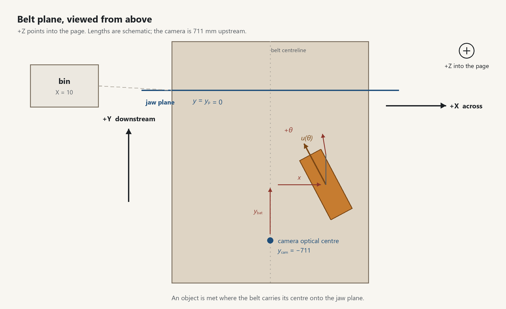
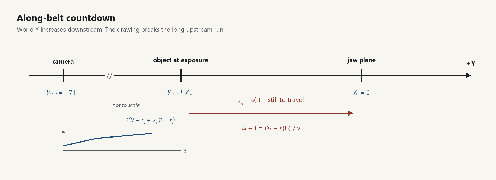
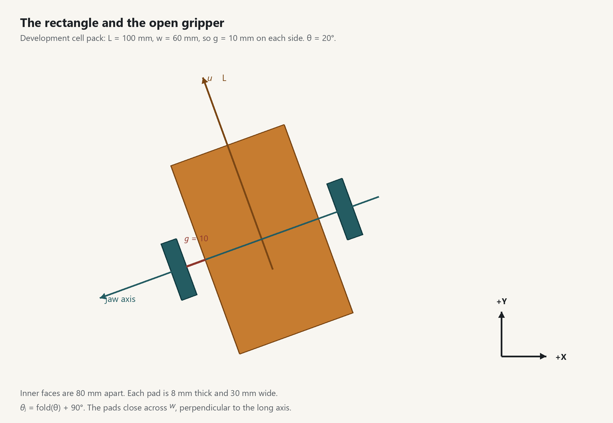
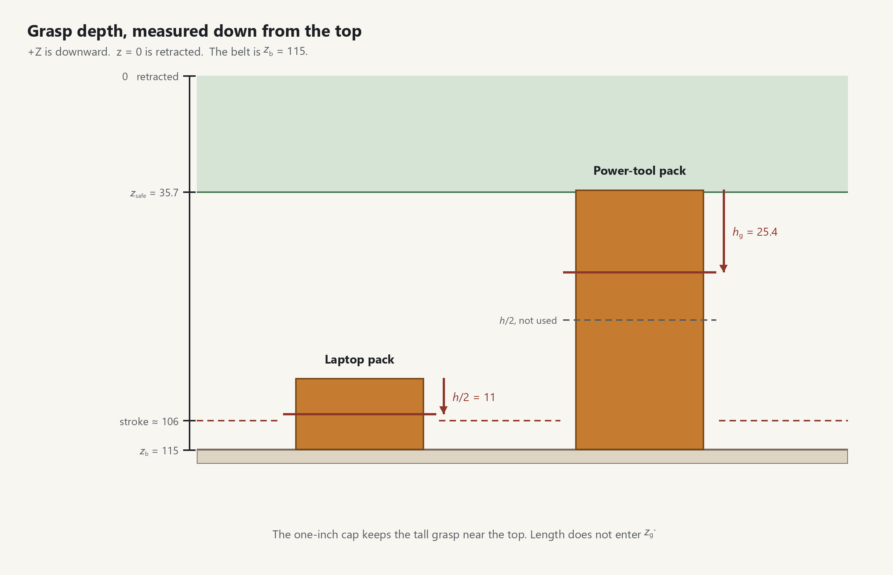
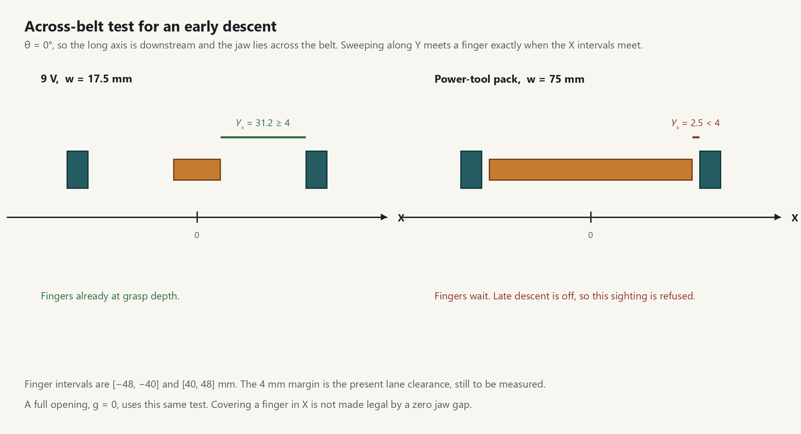
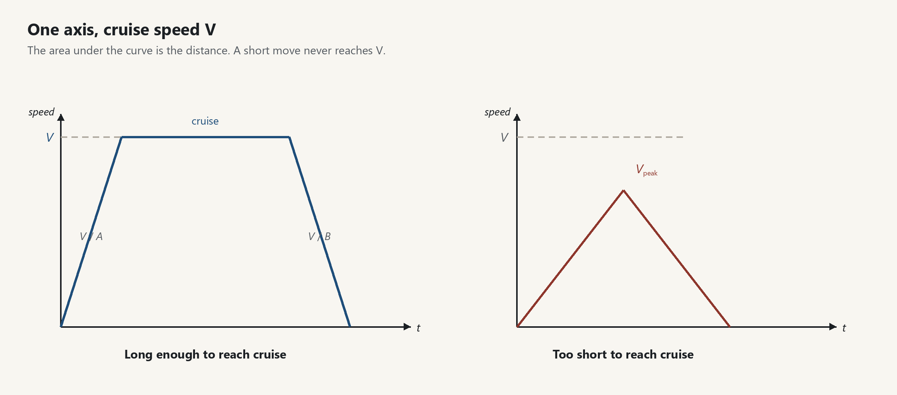
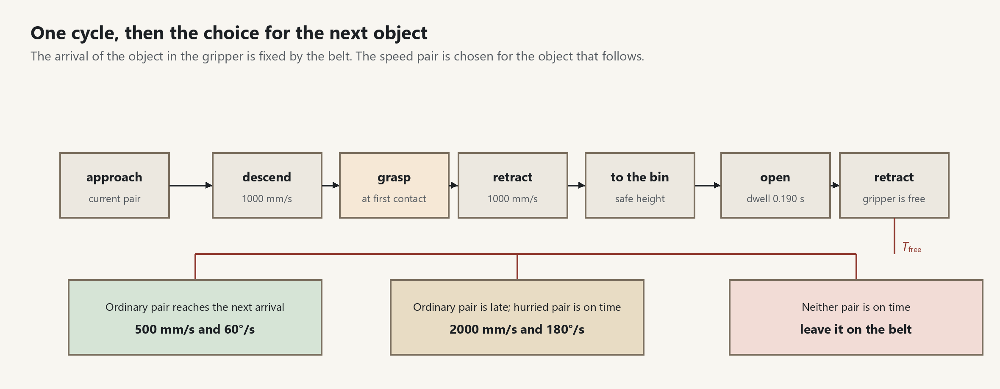
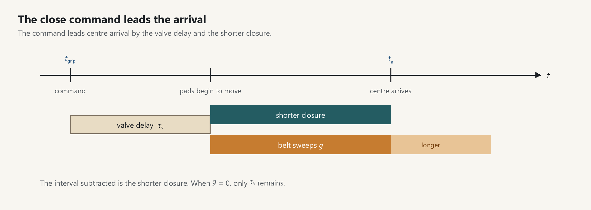

# On-the-Fly Pickup

**Status:** Mathematical narrative of one complete cycle
**Companion:** [PICK_SCHEDULER_KINEMATICS.md](PICK_SCHEDULER_KINEMATICS.md)

A battery lies on a moving belt. The gripper can travel across the belt, rotate in the horizontal plane, and rise and fall. It cannot travel with the belt. The pickup is the problem of meeting that battery at one fixed line across the belt, closing on it while both are still moving, lifting it clear, and setting it in a bin, without striking the battery, its neighbours, or the belt.

The account below is the geometry and the timing of that meeting. Lengths are millimetres, times are seconds, and angles are degrees unless an expression is written in radians. Several numbers are the present working values. Each of those is named where it appears, and the last section lists the ones that measurement is expected to replace.

---

## 1. The fixed frame

The world frame is fixed to the gantry and is right-handed.

- \(+X\) runs across the belt.
- \(+Y\) runs downstream, the direction the belt carries an object.
- \(+Z\) points down, toward the belt.

Joint \(Z = 0\) is the retracted end of the vertical screw. The belt surface is the plane

\[
z = z_b.
\]

The working value is \(z_b = 115\). The jaw centreline is the single plane \(y = y_p\), with working value \(y_p = 0\). There is no actuator along \(Y\). An object is picked by waiting until the belt brings its centre to that plane.

{width=16cm}

*The belt plane. The camera is upstream of the jaw, the object’s across-belt place is \(x\), and its along-belt offset from the camera is \(y_{\mathrm{bat}}\). The drawing is not to the 711 mm camera distance.*

The long axis of an object has angle \(\theta\). At \(0^\circ\) that axis is parallel to \(+Y\). A positive rotation about \(+Z\) turns it from \(+Y\) toward \(-X\). Its unit vector in the belt plane is

\[
\mathbf{u}(\theta) = (-\sin\theta,\ \cos\theta).
\]

At \(\pm 90^\circ\) the long axis lies across the belt. Because a side grip is unchanged if the object is turned through \(180^\circ\), the angle is folded into the half-turn

\[
\theta \in [-90^\circ,\ 90^\circ)
\]

before a jaw angle is chosen. The fold is the unique representative in that half-turn; the physical jaw then selects which of the two opposite joints is the shorter linear travel.

Rotation of the gripper is permitted only while the fingertips are at or above the safe height \(z_{\mathrm{safe}}\). The working ceiling of that band is \(z_{\mathrm{safe}} = 35.7\), measured down from the retracted datum. The gripper finishes its rotation before it leaves the band.

---

## 2. What must be known at the moment of sight

The camera does not report a class and leave the size to be guessed. A sighting is an observation

\[
\big(i,\ x,\ y_{\mathrm{bat}},\ \theta,\ c,\ s_c,\ w,\ L,\ h\big).
\]

Each symbol is part of the observation itself.

- \(i\) is the identity of the object. It is a positive integer, constant for that object during one uninterrupted run of the belt, and different from the identity of every other object in that run. A later sighting of the same object repeats \(i\) and may refine the pose and the size.
- \(x\) is the across-belt coordinate of the centre, measured from the camera. The gantry coordinate is \(x\) plus the camera station. The working station is \(245\), half of the \(300\) belt past the conveyor edge at \(95\). The station and the width are separate settings. Changing the width does not move the station.
- \(y_{\mathrm{bat}}\) is the along-belt offset of the centre from the camera’s optical centre at the instant of exposure. Positive \(y_{\mathrm{bat}}\) is downstream.
- \(\theta\) is the long-axis angle above, reported in \((-180^\circ,\ 180^\circ]\).
- \(c \in \{1,2,3,4\}\) names the class. The class selects the jaw-timing constant. It does not supply a size.
- \(s_c\) is the belt odometer, in millimetres, at the instant of exposure.
- \(w\) is the width, the belt-plane extent perpendicular to \(\mathbf{u}\). The jaws close across \(w\).
- \(L\) is the length, the belt-plane extent along \(\mathbf{u}\).
- \(h\) is the height of the top above the belt. It is not a length and not a width.

An observation is usable when \(i > 0\), the class is one of the four, \(s_c\) was taken at exposure, and

\[
w > 0,\quad L > 0,\quad h > 0,\quad w \le w_{\mathrm{open}}.
\]

The open jaw width is \(w_{\mathrm{open}} = 80\). A wider object does not fit the opening, so the sighting is refused. A missing, zero, or non-finite dimension is likewise refused. There is no silent substitution of a class size.

Until the physical cells have been measured, a stimulating vision source emits these fixed pick bodies. Length, width, and height from the belt are \(L \times w \times h\). Cylinders lie on their side, so width and height are the diameter. Classes 11–13 are pack occupants and are not picked.

| Class | Body | \(L\) | \(w\) | \(h\) |
|---|---|---:|---:|---:|
| 1 | AAA | 44.5 | 10.5 | 10.5 |
| 2 | AA | 50.5 | 14.5 | 14.5 |
| 3 | D | 61.5 | 34.2 | 34.2 |
| 4 | C | 50.0 | 26.2 | 26.2 |
| 5 | 9V, lying flat on larger side | 48.5 | 26.5 | 17.5 |
| 6 | CR123A camera cell | 34.5 | 17.0 | 17.0 |
| 7 | 18650 | 65.0 | 18.3 | 18.3 |
| 8 | 21700 | 70.0 | 21.2 | 21.2 |
| 9 | 26650 | 65.0 | 26.5 | 26.5 |
| 10 | 32650 | 65.0 | 32.0 | 32.0 |
| 11 | Laptop pack, not picked | 205 | 50 | 22 |
| 12 | Li-ion pack, not picked | 114 | 66 | 25 |
| 13 | Power-tool pack, not picked | 120 | 75 | 80 |

These four triples are temporary. They are carried in the observation so that the geometry below can be exercised. Measured envelopes replace them later, observation by observation, without a change in the relations.

The world position of the top of the object at exposure is

\[
\mathbf{p}_c = \big(x,\ \ y_{\mathrm{cam}} + y_{\mathrm{bat}},\ \ z_b - h\big).
\]

The working camera station is \(y_{\mathrm{cam}} = -711\), upstream of the jaw plane. That station is a measured constant waiting to be marked on the machine.

---

## 3. The belt as the only along-track clock

The belt is a scalar odometer \(s\), in millimetres, increasing downstream. Between reports its speed \(v\) is taken as constant, so at a gantry time \(t\)

\[
s(t) = s_k + v_k\,(t - t_k),
\]

where \((s_k, v_k, t_k)\) is the latest accepted report. Its place on the gantry clock is the conveyor timestamp plus the smallest of the last eight differences between gantry receipt and that timestamp.

The centre’s world coordinate along the belt is then a countdown toward the jaw plane:

\[
y(t) = y_p - \big(s_a - s(t)\big).
\]

The odometer value at which the centre reaches \(y_p\) is fixed by the exposure:

\[
s_a = s_c + y_p - \big(y_{\mathrm{cam}} + y_{\mathrm{bat}}\big).
\]

While \(v > 0\), the time still to wait is

\[
t_a - t = \frac{s_a - s(t)}{v}.
\]

{width=16cm}

*The centre reaches the jaw when the odometer reaches \(s_a\). Between reports the odometer is a straight line at the latest speed.*

If the remaining distance is already negative, the centre has passed the plane. If the belt is stopped, there is no finite arrival.

A repeated sequence number is ignored and does not refresh the clock. A new epoch begins when the sequence jumps by more than \(32\), the odometer steps backward by more than \(5\), or the conveyor clock steps backward by more than \(0.500\). An object belongs only to the epoch in which it was sighted; the live set is emptied at the restart. Three reports whose displacement is unchanged, while both the previous and the new speed stay positive, switch the odometer to integration of the previous speed over the conveyor-timestamp gap. The configured report period is \(0.250\). The clock is stale when gantry time since the last accepted report exceeds \(0.500\). That age is receipt time, not the gap between conveyor timestamps. An armed pickup is then abandoned and the gripper returns to the safe height.

The across-belt coordinate \(x\) is constant. The belt does not move it, and the gripper meets the object at that same \(x\).

---

## 4. The body, the gripper, and the depth of the grasp

In its own plane the object is a rectangle of half-length \(L/2\) along \(\mathbf{u}\) and half-width \(w/2\) across \(\mathbf{u}\), rotated by \(\theta\). Its bottom is on the belt at \(z_b\). Its top is at

\[
z_{\mathrm{top}} = z_b - h.
\]

The commanded theta joint is the pad direction. It is parallel to the pad faces and to the cell long axis, and perpendicular to the open/close motion. Theta \(0^\circ\) holds the pads parallel to \(+Y\); the jaws open and close along \(\pm X\).

\[
\theta_{\mathrm{cmd}} = \mathrm{fold}(\theta) + \theta_{\mathrm{offset}}, \qquad \theta_j = \theta_{\mathrm{cmd}} + 90^\circ.
\]

\(\theta_j\) is the open/close axis used by the finger rectangles. The offset \(\theta_{\mathrm{offset}}\) is the small fixed disagreement between the jaw’s mechanical zero and the pads-along-\(+Y\) datum. It is tunable, and its working value is zero. Of the two joints separated by \(180^\circ\), and of their repeats by full turns, the one inside the rotary travel limits with the smaller absolute travel is the command. Travel is ordinary subtraction on the joint line; the joint is not wrapped to take the long way around. A change smaller than \(0.1^\circ\) is left where it is. Any larger command is quantized to \(0.1^\circ\).

The open gripper is two pads. In the present geometric model each pad is a rectangle of thickness \(8\) along the jaw axis and width \(30\) across it, and the pads are centred at

\[
\pm \frac{w_{\mathrm{open}} + 8}{2}
\]

from the jaw centre, along the jaw axis. Those pad dimensions are a model of the fingers, to be replaced by the measured pads.

Closing from the open stop onto the width faces consumes

\[
g = \frac{1}{2}\,(w_{\mathrm{open}} - w) \ge 0
\]

on each side. For the development power-tool pack, \(w = 75\) and \(g = 2.5\). For a body that fills the opening, \(g = 0\): the pads are already on the faces and only have to be commanded closed. A negative \(g\) is the refusal already stated, \(w > w_{\mathrm{open}}\).

{width=15cm}

*A development cell pack at \(20^\circ\). The long axis is \(\mathbf{u}\), the pads stand on the jaw axis, and \(g\) is the gap from each width face to the inner face of a pad.*

The grasp depth is governed by two complementary regimes depending on physical height \(h\) above belt datum \(z_b\):

1. **Short Cell Rule (\(h < 30\,\mathrm{mm}\))**:
   For any battery height strictly smaller than 30 mm, grasp depth is strictly **\(3.0\,\mathrm{mm}\) above the belt surface**:
   \[
   z_g = z_b - 3.0\,\mathrm{mm}
   \]
   At physical simulation datum \(z_b = 105.5\,\mathrm{mm}\), \(z_g = 102.50\,\mathrm{mm}\) (or \(112.0\,\mathrm{mm}\) with bench datum \(z_b = 115.0\,\mathrm{mm}\)).

2. **Tall Cell Rule (\(h \ge 30\,\mathrm{mm}\))**:
   For batteries with height \(h \ge 30\,\mathrm{mm}\), grasp depth is measured down from the object top surface, targeting half the height capped at a maximum insertion depth of 25.4 mm (1.0 inch):
   \[
   h_g = \min\!\left(\frac{h}{2},\ 25.4\,\mathrm{mm}\right), \qquad z_g = (z_b - h) + h_g.
   \]

### Calibrated Battery Profiles & Grasp Elevations

| Category | Battery Class / Form | Dimensions \(L \times w \times h\) (mm) | Height \(h\) | Grasp Rule | Grasp \(z_g\) (\(z_b=105.5\)) |
|:---|:---|:---:|:---:|:---:|:---:|
| **Cylindrical** | AAA | \(44.5 \times 10.5 \times 10.5\) | \(10.5\,\mathrm{mm} < 30\) | 3mm from belt | \(102.50\,\mathrm{mm}\) |
| | AA | \(50.5 \times 14.5 \times 14.5\) | \(14.5\,\mathrm{mm} < 30\) | 3mm from belt | \(102.50\,\mathrm{mm}\) |
| | 18650 | \(65.0 \times 18.3 \times 18.3\) | \(18.3\,\mathrm{mm} < 30\) | 3mm from belt | \(102.50\,\mathrm{mm}\) |
| | 21700 | \(70.0 \times 21.2 \times 21.2\) | \(21.2\,\mathrm{mm} < 30\) | 3mm from belt | \(102.50\,\mathrm{mm}\) |
| | C | \(50.0 \times 26.2 \times 26.2\) | \(26.2\,\mathrm{mm} < 30\) | 3mm from belt | \(102.50\,\mathrm{mm}\) |
| | D | \(61.5 \times 34.2 \times 34.2\) | \(34.2\,\mathrm{mm} \ge 30\) | Top \(- h/2\) | \(103.40\,\mathrm{mm}\) |
| **Prismatic / Pack** | 9V (`nine_volt_flatface`) | \(48.0 \times 27.0 \times 17.0\) | \(17.0\,\mathrm{mm} < 30\) | 3mm from belt | \(102.50\,\mathrm{mm}\) |
| | `nine_volt_shortface` | \(48.0 \times 17.0 \times 27.0\) | \(27.0\,\mathrm{mm} < 30\) | 3mm from belt | \(102.50\,\mathrm{mm}\) |
| | `nine_volt_bottomface` | \(27.0 \times 17.0 \times 48.0\) | \(48.0\,\mathrm{mm} \ge 30\) | Top \(- h/2\) | \(81.50\,\mathrm{mm}\) |
| | `pack` (flat) | \(114.0 \times 68.0 \times 26.0\) | \(26.0\,\mathrm{mm} < 30\) | 3mm from belt | \(102.50\,\mathrm{mm}\) |
| | `pack_shortface` | \(114.0 \times 26.0 \times 68.0\) | \(68.0\,\mathrm{mm} \ge 30\) | Top \(- 25.4\) | \(62.90\,\mathrm{mm}\) |
| | `laptop` | \(208.0 \times 50.0 \times 21.0\) | \(21.0\,\mathrm{mm} < 30\) | 3mm from belt | \(102.50\,\mathrm{mm}\) |
| | `power_tool` | \(112.0 \times 75.0 \times 80.0\) | \(80.0\,\mathrm{mm} \ge 30\) | Top \(- 25.4\) | \(50.90\,\mathrm{mm}\) |

{width=16cm}

*Positive \(Z\) points down. For all cells with \(h < 30\,\mathrm{mm}\), the grasp depth \(102.50\,\mathrm{mm}\) sits cleanly 3.0 mm above the belt datum, comfortably within the 105.5 mm stroke limit. Tall packs are staged dynamically with \(z_{\mathrm{stage}} = \min(Z_{\mathrm{safe}}, \max(15.0, z_{\mathrm{top}} - 6.0\,\mathrm{mm}))\) before plunge.*

---

## 5. Whether the fingers may already be down

At time \(t\) the object centre is \((x,\ y(t))\). The gripper is clear of the object when the object rectangle and both finger rectangles are disjoint. For two rectangles that test is the separating-axis test: project both onto the outward normal of each of the four edges, and declare a miss as soon as one projection separates them.

Sweeping a rectangle along \(Y\) meets a finger exactly when their \(X\) intervals overlap. Let \(\gamma_x\) be the gap from the object’s \(X\)-interval to the nearer finger. The fingers may already be at \(z_g\) on arrival if and only if \(\gamma_x \ge 4\) for the whole pass. A full opening, \(g = 0\), does not waive that test.

{width=16cm}

*At \(\theta = 0^\circ\) the 9 V body clears both fingers by 26.75 mm, so the fingers may already be down. The power-tool body clears them by 2.5 mm and fails the test.*

### Finger Proximity Invariant & Contact Tribology
The fingers must never be held wide open ($w_{\mathrm{open}} = 80\,\mathrm{mm}$) at grasp depth. Pre-closure synchronizes the jaws to tight proximity ($W_{\mathrm{jaw}} = w + 1.8\,\mathrm{mm}$) upon Z touchdown. At the instant of first contact with the downstream finger ($d_{\mathrm{down}} = 0$), the upstream finger clearance is strictly required to satisfy:
\[
d_{\mathrm{up}}(t_{\mathrm{contact}}) = W_{\mathrm{jaw}}(t_{\mathrm{contact}}) - w = 1.80\,\mathrm{mm} < 3.0\,\mathrm{mm}
\]
across all belt speeds ($200 - 1500\,\mathrm{mm/s}$) and orientation angles ($0^\circ - 90^\circ$). The finger material is 3D-printed PLA plastic ($\mu = 0.28$) gripping deep-drawn stainless steel / nickel-plated battery casings ($\mu = 0.35$). The resulting normal clamping force $F_n = 18.5\,\mathrm{N}$ provides a vertical extraction safety margin factor $S_f \ge 4.5$ against inertial and gravitational slip.

Centre arrival \(t_a\) is not first contact. The downstream pad meets the body earlier when the belt has a component along the jaw:

\[
t_{\mathrm{contact}} = t_a - \frac{g}{v f}\quad(g > 0,\ f > 0),\qquad t_{\mathrm{contact}} = t_a\quad\text{otherwise},
\]

with \(f = |\cos\theta_j|\). The fingertips are at \(z_g\) one guard before that instant, whether the descent was early or late:

\[
t_{z,\mathrm{done}} \le t_{\mathrm{contact}} - \tau_{\mathrm{guard}}.
\]

If the lane is clear, the descent starts as soon as the across-belt move and the rotation have finished. If it is not, the fingers wait at a hover and descend only after the object has passed the upstream finger. Late descent stays off until the bench accepts it; until then a failed lane test is a refusal.

Hover is never more retracted than the safe ceiling, and it clears the tallest tracked top, including the one being picked:

\[
z_{\mathrm{hover}} = \max\big(z_{\mathrm{safe}},\ z_b - h_{\mathrm{tallest}} - 3\big).
\]

Late descent is released so it finishes one guard before \(t_{\mathrm{contact}}\). Let \(\tau_{\mathrm{top}}\) be the time from that release until the fingertips pass \(z_{\mathrm{top}}\), and \(\tau_{\mathrm{tail}}\) the time until \(z_g\). The along-jaw gap is swept in

\[
W =
\begin{cases}
2g / (v f) & g > 0,\ f > 0, \\
\infty & g > 0,\ f = 0, \\
0 & g = 0.
\end{cases}
\]

The buried part of the descent, with a guard on either side, must fit in that sweep:

\[
W \ge 2\,(\tau_{\mathrm{tail}} - \tau_{\mathrm{top}} + \tau_{\mathrm{guard}}).
\]

A shorter window, or a descent that cannot finish by \(t_{\mathrm{contact}} - \tau_{\mathrm{guard}}\), is a refusal. The 4 mm lane, the 3 mm hover, and \(\tau_{\mathrm{guard}} = 0.015\) are provisional. The rectangles are rigid and rest flat on the belt.

While the fingertips are below the tops, every other tracked object is held to the same separating-axis test. The occupation lasts from the moment the fingertips pass the highest relevant top until they have retracted above every such top. An object whose \(X\)-interval meets a finger, and whose \(Y\) passage overlaps that occupation, delays the descent until it has gone by. If no such delay still leaves the grasp on time, the pickup is refused.

---

## 6. How long a move takes

A single axis moving a distance \(D > 0\) at cruise speed \(V\) and with acceleration \(A\) and deceleration \(B\) takes the trapezoid time

\[
T(D, V, A, B) =
\begin{cases}
D / V & A \le 0 \text{ or } B \le 0, \\[4pt]
\dfrac{V}{A} + \dfrac{V}{B} + \dfrac{D - D_{\mathrm{ramp}}}{V} & D \ge D_{\mathrm{ramp}}, \\[8pt]
\dfrac{V_{\star}}{A} + \dfrac{V_{\star}}{B} & D < D_{\mathrm{ramp}},
\end{cases}
\]

where the distance spent in the two ramps, and the peak speed of a triangular move, are

\[
D_{\mathrm{ramp}} = V^2\left(\frac{1}{2A} + \frac{1}{2B}\right), \qquad V_{\star} = \sqrt{\frac{2D}{1/A + 1/B}}.
\]

{width=16cm}

*A long move reaches the cruise speed \(V\). A short move peaks at \(V_{\star}\) and has no cruise. The area under either curve is the distance.*

The working linear acceleration and deceleration are both \(3000\). The working rotary acceleration and deceleration are both \(1800\) degrees per second squared. A zero distance takes zero time. A positive distance at zero speed is treated as not completable.

The vertical screw has its own ceiling, the critical speed of the ballscrew rather than the nameplate of the motor:

\[
v_z = 3000\,\mathrm{rpm} \times \frac{20\,\mathrm{mm/rev}}{60} = 1000\,\mathrm{mm/s}.
\]

Descent to \(z_g\) and retract to the staging ceiling \(z_{\mathrm{safe}}\) are commanded at symmetric critical speed \(v_{\mathrm{plunge}} = v_{\mathrm{retract}} = v_z = 1000\,\mathrm{mm/s}\) with acceleration and deceleration \(a_z = 20{,}000\,\mathrm{mm/s^2}\) (Allen-Bradley Kinetix 5100 servo capability). At grasp depth \(z_g\), vertical motion reverses instantly with zero dwell (\(t_{\mathrm{retract}} = t_{z,\mathrm{done}}\), \(\mathrm{dwell} = 0.0\,\mathrm{s}\)). 

Drive position commands execute 100% Velocity Feedforward (VFF) lead compensation:
\[
z_{\mathrm{cmd}}(t) = z(t) + \tau_{\mathrm{vff}} \dot{z}(t), \qquad \tau_{\mathrm{vff}} = \frac{k_v}{k_p} = 0.007\,\mathrm{s} = 7.0\,\mathrm{ms}
\]
which eliminates servo lag (\(\Delta z = \frac{k_v}{k_p} \dot{q}\)), guarantees exact tracking across the high-speed reversal at \(z_g\), and prevents erratic velocity spikes during retract. The ceiling is not raised. If the drive’s own velocity limit lies below \(1000\), that limit is what the trapezoid must use until the drive is opened up to \(v_z\).

Across-belt and rotary motion use one of two pairs, and no speed outside them.

- The ordinary pair is \(500\,\mathrm{mm/s}\) and \(60^\circ/\mathrm{s}\).
- The hurried pair is \(2000\,\mathrm{mm/s}\) and \(180^\circ/\mathrm{s}\).

Acceleration is the same for both. The object already being approached keeps the pair it was given. The hurried pair is assigned only to a following object, after the bin.

The time to settle into the approach pose is the later of the across-belt trapezoid and the rotary trapezoid, each enlarged by the short fixed allowances for starting the rotary axis and for settling at the end. The vertical stroke is then added at \(v_z\). After the approach has been committed, a new belt report revises only \(t_a\), the grip instant, and the descent instant. It does not choose a new across-belt target or a new jaw angle. The jaw and the current height stay as they were when the descent began. A refined angle that would change a clear lane into an occupied one abandons the pickup.

---

## 7. The cycle, and which pair the next object receives

Number the objects \(1, 2, \ldots\) in order of their arrivals \(t_a^{(1)} < t_a^{(2)} < \cdots\).

Object \(n\) keeps the speed pair it already has. The open gripper moves at the safe height to \((x^{(n)}, \theta_j^{(n)})\), descends to \(z_g^{(n)}\) at \(v_z\), meets the faces at \(t_{\mathrm{contact}}\), retracts to \(z_{\mathrm{safe}}\), transfers to the bin, opens, and retracts again.

The bin is at across-belt coordinate \(10\), drop height \(90.8\), jaw \(90^\circ\), open dwell \(0.190\). A tunable choice leaves the jaw at the pickup angle. The transfer uses the ordinary pair, including after a hurried approach. Vertical parts of the drop use \(v_z\).

\(T_{\mathrm{free}}^{(n)}\) is the time until that second retract ends and the gripper can start toward object \(n+1\). It is measured from the bin pose. \(t_a^{(n)}\) is fixed by the belt, so the pair is chosen for \(n+1\):

- The ordinary pair, if it reaches \(t_a^{(n+1)}\) from the bin.
- The hurried pair, if the ordinary pair is late and the hurried pair is on time.
- Left on the belt, if neither pair is on time.

{width=16cm}

*Object \(n\) keeps its pair. At \(T_{\mathrm{free}}\) the next object receives the ordinary pair, the hurried pair, or is left on the belt.*

Two objects closer than the dedupe neighbourhood in both odometer and across-belt position are one object. The working neighbourhood is \(40\) in each. A repeated identity \(i\) is the same object even when the refined pose has moved. The live set holds at most sixteen objects. A sighting beyond \(1500\) upstream of the jaw plane, or more than \(25\) downstream of it, is outside the window and is not kept.

---

## 8. The instant the pads meet

\(t_a\) is centre arrival. First contact is \(t_{\mathrm{contact}}\) from §5.

The jaw speed \(v_j\) has working value \(210\). The valve delay \(\tau_v\), working value \(0.030\), runs from the command until the pads begin to move. A positive class contact time \(\tau_c\) replaces \(g / v_j\), including when the observation supplied \(w\). Otherwise the jaw time is \(g / v_j\). The belt closes the same gap at \(v f\), so the command leads the centre arrival by the valve delay and by the shorter closure:

\[
\tau_{\mathrm{close}} =
\begin{cases}
\tau_c & \tau_c > 0, \\
g / v_j & \tau_c = 0,\ v_j > 0,
\end{cases}
\qquad
t_{\mathrm{grip}} = t_a - \tau_v - \min\!\big(\tau_{\mathrm{close}},\ g / (v f)\big).
\]

{width=16cm}

*The command leads the arrival by the valve delay and by the shorter closure. In the drawing the jaw is the shorter one, so it is the interval that is subtracted; the belt would still be closing at \(t_a\).*

When `pk_bench` is on, that shortcut is not the schedule. Z release and the close command are the coordinated pair from [PICK_SCHEDULER_KINEMATICS.md](PICK_SCHEDULER_KINEMATICS.md) §4. Valve-on is 8 ms (`pk_von_ms`), not the stored 30 ms `cv_valve_ms`. Retract begins on the instant Z reaches grasp depth \(z_g\) with zero dwell (\(t_{\mathrm{retract}} = t_{z,\mathrm{done}}\), \(\mathrm{dwell} = 0.0\,\mathrm{s}\)). 

At \(t_{z,\mathrm{done}}\), the battery is already between the closing fingers with tiny clearance \(\delta_{\mathrm{clear}} \le 1.5\,\mathrm{mm}\) (\(W_{\mathrm{jaw}} = w + 1.8\,\mathrm{mm}\)), ensuring normal force into the battery at bottom is strictly zero (\(F_N = 0.0\,\mathrm{N}\)). Full grasp completes immediately after (and only after) Z retract has initiated, clamping the battery securely against ascent acceleration within the first millimetre of upward travel. The delay between the start of retract and full grasp:
\[
\Delta t_{\mathrm{delay}} = (t_{\mathrm{close}} + \tau_{\mathrm{grip}}) - t_{z,\mathrm{done}}
\]
is governed directly by when the close command was fired during the plunge.

In firmware, scheduling executes in discrete FreeRTOS ticks at \(1000\,\mathrm{Hz}\) (\(T_{\mathrm{tick}} = 1.0\,\mathrm{ms}\)). The close command trigger is scheduled as:
\[
N_{\mathrm{close\_ticks}} = \mathrm{round}\left(\frac{t_{\mathrm{close}} - t_z}{T_{\mathrm{tick}}}\right) + \Delta N_{\mathrm{offset\_ticks}}
\]
where \(\Delta N_{\mathrm{offset\_ticks}}\) is the tunable discrete tick offset exposed in the simulation controls, shifting the valve firing by exact integer milliseconds to calibrate the ascent clamping instant.

When \(v f = 0\) only the jaw closure remains. When \(g = 0\) the lead is the valve delay alone. \(\tau_v\), each \(\tau_c\), \(v_j\), and \(\tau_{\mathrm{guard}}\) stay tunable.

A completed close means the valve was commanded and the timed closure has elapsed. It is not a measurement that the object is in the gripper. The gripper still carries the object to the bin, and it does not start another pickup until the bin open has completed.

---

## 9. Refusals

The pickup is refused, rather than attempted on a guess, when any of the following holds.

- The observation is incomplete, the class is outside \(\{1,2,3,4\}\), the identity is missing, or the exposure was not tied to the belt odometer.
- The width exceeds the opening, or the grasp depth is outside the stroke.
- No jaw angle inside the rotary limits is perpendicular to the long axis.
- The lane is occupied and late descent is disabled, or late descent is enabled and the sweep window or the guard cannot be met.
- Another object occupies a finger throughout every descent that would still finish on time.
- The belt is stopped, the clock is stale, or the epoch has changed.
- At the moment of the decision, the approach and the descent cannot both finish by \(t_{\mathrm{contact}} - \tau_{\mathrm{guard}}\), or the grip command would already lie in the past.
- The following object cannot be met from the bin by either speed pair. That object is refused; the object already in the window is still picked on its own belt time.

A refusal after the gripper has descended returns the fingertips to \(z_{\mathrm{safe}}\) at \(v_z\). The same return is used when the belt stops, the clock goes stale, the epoch restarts, a refined angle spoils a clear lane, or the valve command fails.

---

## 10. Numbers that measurement replaces

The relations in this account are the pickup. The following values are the present numerical model, and they are the ones marked for later measurement.

- The ten pick bodies and the three pack occupants in the class table above.
- The belt plane \(z_b = 115\), the belt width \(300\), the camera stations \(y_{\mathrm{cam}} = -711\) and across-belt \(245\), and the jaw offset of zero.
- The finger rectangles, thickness \(8\) and width \(30\), in an opening of \(80\).
- The lane margin \(4\), the hover clearance \(3\), and the timing guard \(0.015\). These three belong to the late descent and stay provisional while that descent remains disabled.
- The valve delay \(0.030\), the jaw speed \(210\), and the four class contact times, each left at zero so that \(g / v_j\) is used until a measured \(\tau_c\) is entered.
- The bin pose \((10,\ 90.8,\ 90^\circ)\) and the opening dwell \(0.190\).
- The assumption that every body is a rigid rectangle resting flat on the belt, and that a timed valve closure is a held object.

The speed pairs, the one-inch grasp cap, the screw ceiling \(v_z = 1000\), and the rule that the hurried pair is spent on the following object after the full cycle, are the motion policy of the pickup.
