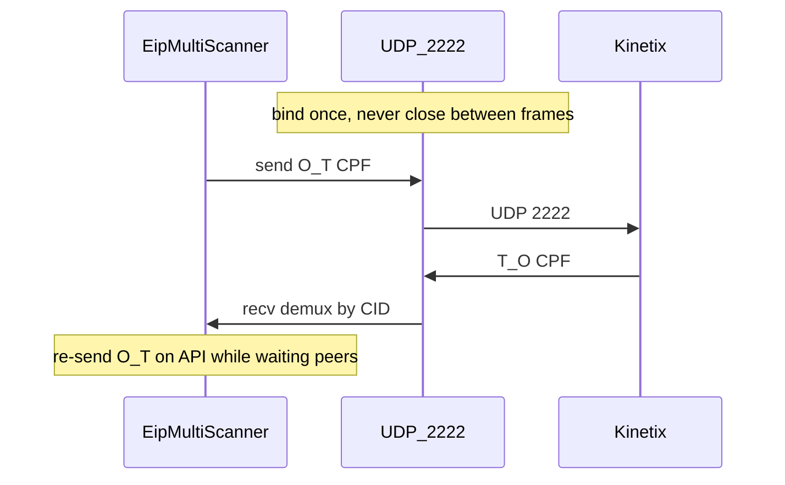

*[README](../../README.md) › [Knowledge transfer](../../docs/KNOWLEDGE_TRANSFER.md) › [Gantry firmware](../../GANTRY_FIRMWARE.md) › [Libraries](../README.md) › [EtherNetIP](README.md) › Reference*

# EtherNetIP reference

**Read this when** you need an exact fact: a signature, a unit, a timeout, a key or a return value.

Public headers are under `lib/EtherNetIP/src/`. Units below are the ones in those headers. The motion math is not on this page.

## Layers

| Header | What it holds |
|---|---|
| `EipEncapsulation.h`, `EipCpf.h`, `CipMessageRouter.h`, `EipConnectionManager.h` | Codecs. RPI and the actual packet interval are microseconds |
| `Kinetix5100Assembly.h` | Output 104 and input 154. `speed_reference` is commented 0.1 RPM (`:62`); `actual_speed` is commented RPM (`:111`) |
| `Hcs01Assembly.h`, `Hcs01ControlStatus.h` | HCS01 instances 101 and 102 |
| `EipSession.h` | Explicit messages. Default timeout 500 ms. `kMaxFrameSize` is 512 |
| `EipMultiScanner.h` | Production scanner: open, drain, exchange, reopen |
| `EipClass1Timing.h` | Pace, stale policy, `ExchangeStatus` |
| `EipScannerTask.h` | `startScannerTask`, `pauseClass1`, `resumeClass1`, `dumpClass1TimingStats`, `printLastClass1GapReport` |

`multiAxisTask` calls `multiAxisConnectAndRun`, which calls `multiAxisCyclic`, which calls `multiAxisRecover` (`EipScannerTask.cpp`).

## Tasks

| Task | Core | Priority | Stack | Where |
|---|---:|---:|---:|---|
| `EipScannerM` | 1 | 6 | 8,192 | `kScannerCore`, `kScannerPriority`, `kScannerStack` |
| `EipHoldKA`, `EipReopenKA`, `EipCloseKA` | 1 | 7 | 4,096 | `kKeepalivePriority`, `kKeepaliveStack` |
| `EipLog` | 0 | 2 | 4,096 | `kLogTaskCore`, `kLogTaskPriority`, `kLogTaskStack` |

Hold keepalive period is 5 ms. Reopen keepalive is `kReopenKeepalivePeriodMs` = 2 (`EipScannerTaskInternal.h:105`).

## Timing the code uses

| Constant | Value | Line |
|---|---|---|
| `kReconnectIdleMs` | 500 ms | `EipScannerTaskInternal.h:70` |
| `kLinkSettleMs` | 300 ms | `EipScannerTaskInternal.h:69` |
| `kPostResetSettleMs` | 100 ms | `EipScannerTaskInternal.h:71` |
| soft T→O misses | 2 (`shouldTeardownAfterInputMisses` default) | `EipClass1Timing.h:71–73` |
| `kClass1StaleTeardownRpiMultiples` | 10 | `EipClass1Timing.h:79` |
| `kClass1StaleGateGraceRpiMultiples` | 3 | `EipClass1Timing.h:81` |
| `kClass1ConnectionTimeoutMultiplier` | 2 (CIP timeout = RPI × 4 << code) | `EipScannerPolicy.h:16–19` |
| `kMaxChipRecovers` | 3 | `EipScannerPolicy.h:12` |
| chip-recover backoff | start 1,000 ms, double, cap 5,000 ms | `EipScannerPolicy.h:13–14` |
| overrun yield | every 8 consecutive overruns | `EipClass1Timing.h:50` |

After `kMaxChipRecovers`, `escalateChipRecover` waits 10 s, clears the streak and retries (`EipScannerTaskInternal.h:347–353`). It does not call `esp_restart`. The comment at `EipScannerTask.h:7` still says `esp_restart`.

`ExchangeStatus` (`EipClass1Timing.h:119–123`): `kOk`, `kOutputSendFailed` (chip recover), `kInputMiss` (soft retry).

## Locks the Class 1 path takes

The W5500 bus mutex, the SPI3 Class 1 critical section (`spi3_class1_critical_enter` in `EipScannerTask.cpp`), and the process-image mutex inside `sendAxisOutput` / `applyFeedback`. The process-image mutex is also taken from `Gantry` on other tasks. G-B17. Socket logs inside `exchangeOnce` are G-B16.

## AppConfig

This component does not read the stored target IP, RPI or PUU keys. `hcs01_eng_ip` is not read; COMWS uses `kDefaultEngIp` (`Hcs01ComwsClient.h`). G-B5.

## Console

| Command | Call |
|---|---|
| `eiptiming` | `dumpClass1TimingStats` |
| `gaptrace` | `printLastClass1GapReport` |
| `cfg save` | `pauseClass1` (`src/gantry_console_cfg.cpp:97`) |

`ethlink` and `drv` are console commands in `src/gantry_console_commands.cpp` whose handlers use this library.

## Errors

`ExchangeStatus` above is the result of one Class 1 exchange. `pauseClass1` returns false when Class 1 does not close within its timeout, and `cfg save` then does not save (`src/gantry_console_cfg.cpp:97`). `startScannerTask` returns nothing.

## Usage

```cpp
// src/main_init_motion.cpp, once w5500.init() has succeeded
eip::startScannerTask(w5500, w5500Hal, w5500LinkStatus, &eipImageX, &eipImageZ, &eipImageTheta);
```

## Known issues

Found in the library review of 2026-11-26 (at `1caa98c`) and not tracked as open items. Not re-checked since; confirm against the code before acting.

| # | Category | Location | Finding | Evidence |
|---|---|---|---|---|
| E4 | bug, latent | `EipMultiScannerConnect.cpp:161-166` | `bindSharedUdp()` never joins a multicast group, so `CONFIG_EIP_TO_POINT_TO_POINT=n` would leave every axis stale. Production uses P2P | Confirmed |
| E6 | risk | `EipMultiScanner.cpp:175, 188` | The drain applies the oldest T->O frame per axis and discards newer ones read in the same cycle. The test asserts this | Confirmed; impact Suggested |
| E7 | risk | `EipScannerTaskInternal.h:327-340, 391-410` | During a per-axis reopen (up to about 6.5 s: TCP connect, RegisterSession up to 5 s, attribute 13, Forward_Open) the keepalive helper never checks X/Z feedback age | Confirmed |
| E8 | bug, low probability | `EipScannerTaskInternal.h:373-384` | `stopKeepalive` gives up after 50 ms while the helper still holds a pointer to a context on the caller's stack | Confirmed |
| E9 | docs/risk | `EipScannerTask.h:36-41`; `gantry_console_cfg.cpp:13, 97-99` | If the 5 s `pauseClass1` timeout expires after the task broke out for the planned close, Class 1 is already closed yet `cfg save` reports that it did not close | Suggested: time a dropped-session save (G-B1) |
| E11 | error handling | `Hcs01ComwsClient.cpp:51-58, 98-186, 332-388` | `runCommand` ignores every `setVar` result. `runAutotune` ignores two arguments and always reports success. HTTP status is never checked and responses truncate at 1,023 bytes | Confirmed |
| E12 | error handling | `EipScannerConfig.cpp:119`; `EipScannerTask.cpp:174`; `Kinetix5100ParamAccess.cpp:24-31`; `EipMultiScannerConnect.cpp:261-265` | `acquireBus()` result discarded; empty payload for sizes other than 2 or 4; "CIP status 0x00" logged when the transport failed | Confirmed |
| E13 | docs, cross-library | `Kinetix5100Assembly.h:111` vs `GantryEipLinearAxisPhases.cpp:288, 364` | The header calls `actual_speed` RPM, as does the manual text extract (2198-UM004D, Table 106). Gantry's `kNearStopSpeedRef = 50` and `GANTRY_FIRMWARE.md:600` treat it as 0.1 RPM. If the manual is right, "near stop" is 50 RPM | Suggested: jog at a known speed reference, compare `actual_speed`, check the manual page |
| E14 | docs | `EipScannerTask.h:5-7`, `EipMultiScanner.h:69`, `EipMultiScanner.cpp:135`, `EipTransport.h:111`, `Kconfig:10, 116-128, 198-209`; the old firmware doc's Class 1 section (now the Class 1 lifecycle above) | Stale: theta path, stale multiple (10×, not 3×), frame size (512, not 4 KiB), the MQTT mention, PUU help, run/idle help. The doc's recover-ladder and constants tables disagree with the code: soft misses 2 not 3; 10 s backoff, not a restart; cap 5,000 ms; reconnect idle 500 ms; multiplier 2; reset through MCP PB7 | Confirmed |
| E15 | risk | `EipSocketW5500.cpp:32-37` | 7 of 8 W5500 sockets are in use. A second concurrent explicit or COMWS connection fails | Confirmed count |
| E16 | cleanup | `EipClass1TimingStats`, `EipMultiScanner.cpp:167`, `KinetixFaultCodes.h:110-115` | Unsynchronised diagnostic counters; a static shared across scanner instances; a latent index past `tmp` on `snprintf` truncation | Confirmed |

**Dead code:**
- unused API: `buildListIdentityRequest`, `encodeSendUnitDataPayload`, `kOutputInstance106`, `udpBound`, the `EtherNetIP.h` umbrella header
- production-dead: `EipScanner` and `singleAxisTask`, theta-only builds
- unread Kconfig options: `EIP_TARGET_IP`, `EIP_INCLUDE_RUN_IDLE_HEADER`
- four unused parameter IDs
- the stray root-level `autotune_cmd.cpp` (X-5, deleted 2026-11-27)

**Not covered by host tests:**
- the `multiAxisTask` state machine, pause and resume, reopen and planned close
- `Kinetix5100TuningClient`
- COMWS `runCommand`, `runAutotune` and HTTP errors
- `formatDriveTripSummary`
- a split or late explicit reply
- multicast
- two frames per axis in one cycle

## Class 1 lifecycle

This section is the normative explanation of cyclic EtherNet/IP on this project.

### Explicit vs implicit

| Path | Port | Content | Lifetime |
|------|------|---------|----------|
| Explicit (TCP) | **44818** | Encap header + RegisterSession / SendRRData(ForwardOpen 0x54) / ForwardClose 0x4E / UnRegisterSession | Only for open/close and rare explicit CIP |
| Implicit Class 1 (UDP) | **2222** | **Raw CPF only** — no 24-byte encap header | Every RPI for as long as torque must hold |

Session + FO live in [`EipSession`](src/EipSession.cpp) /
[`EipConnectionManager`](src/EipConnectionManager.cpp) /
[`EipScanner`](src/EipScanner.cpp).  
Cyclic frames live in [`EipIoConnection`](src/EipIoConnection.cpp) /
[`EipCpf`](src/EipCpf.cpp).

ForwardOpen path (Kinetix X/Z): config assembly **191 (0xBF)** + O→T **104** + T→O **154**
(`buildAssemblyConnectionPath`; EDS-style path `20 04 24 BF 2C 68 2C 9A`).
Transport class/trigger = Class 1 cyclic (`0x01`). Granted API (`ot_api_us` /
`to_api_us`) drives RPI pacing and recv timeout (`API_ms * 8 + 50`).

Firmware FO overrides in `makeKinetixConfig` ([`EipScannerConfig.cpp`](src/EipScannerConfig.cpp)):

- CTM = **2**: connection timeout = RPI × 4 << 2 = 16 × RPI, 32 ms at 2 ms (`kClass1ConnectionTimeoutMultiplier`, `EipScannerPolicy.h`)
- P2P T→O by default
- O→T CID seeds `0x10000001` (X) / `0x10000002` (Z)
- T→O CID `0x20000000 | serial`
- Run/Idle **bytes** on the wire; **bit 8 in network params left clear** (Kinetix quirk)

### CPF frame shape

Datagram = CPF only:

1. Sequenced address item type **`0x8002`** — connection ID + 32-bit encap sequence.
2. Connected data item type **`0x00B1`** — CIP sequence (u16) + optional Run/Idle (u32, typically `0x1`) + assembly payload.

| Direction | Builder / parser | Demux key |
|-----------|------------------|-----------|
| O→T (originator → target) | `buildOutputFrame` → `buildClass1OutputCpf` | Sent to drive IP:2222 with O→T CID |
| T→O (target → originator) | `parseInputFrame` / `parseClass1InputCpf` | Sequenced-address CID (usually T→O CID) |

Kinetix T→O typically has **no** Run/Idle strip on parse (`to_include_run_idle_header` false for input). Sequence counters reset on reconnect.

O→T connected size on wire when Run/Idle enabled = 40 (assy 104) + 2 (CIP seq) + 4 (Run/Idle) = **46**.

### Persistent UDP invariant (do not regress)



**Correct pattern:** bind UDP **2222 once** for the Class 1 lifetime → loop send O→T / recv T→O → only close on ForwardClose / teardown.

**Wrong pattern:** bind → send → recv → **close** → bind again next frame.

Why wrong fails:

1. In the gap after close, the drive’s T→O unicast hits a closed port.
2. The host stack replies **ICMP port unreachable**.
3. The drive tears down Class 1 and **releases torque with no keypad fault**.

PC harness history (same invariant): [`tools/eip_test.py`](../../tools/eip_test.py) module docstring — fixed with `exchange_io_frame(..., reuse_socket=True, drain=True)` and a persistent `io_sock`. Firmware P2P keeps T→O on one W5500 UDP socket bound to **2222** and opens one TX socket per dest IP so DIPR stays cached ([`EipSocketW5500Udp`](src/EipSocketW5500.cpp)).

A Class 1 connection only holds torque while O→T keeps arriving within the connection timeout. Stalling longer than that timeout silently drops the connection.

### Dual-axis scanner loop

[`EipMultiScanner`](src/EipMultiScanner.cpp) + task in [`EipScannerTask.cpp`](src/EipScannerTask.cpp):

1. `openAxis(0)` (TCP FO on X).
2. `bindSharedUdp()` — one socket on 2222 for both axes.
3. Spawn **`EipHoldKA`** (~5 ms) so X keeps receiving O→T while Z’s FO runs.
4. `openAxis(1)` (Z); then `openAxis(2)` (HCS01 theta, non-fatal if FO fails).
5. HoldKA **drains T→O** so the shared UDP RX cannot overflow. After FO, a short prime loop sends O→T to every dest (ARP / DIPR) and drains again.
6. Cyclic `exchangeOnce`:
   - Send O→T for all axes starting at a **rotating** index (fairness). P2P O→T uses **one W5500 UDP socket per dest** so DIPR/DPORT stay cached. Cached-dest SEND returns without polling SENDOK; the next send on that socket confirms it (TIMEOUT/DISCON still escalates `kOutputSendFailed`, one cycle late). Dest-change SENDOK wait is **10 ms** so the first packet to a new IP is not aborted mid-ARP. TCP `socketSend` stays blocking.
   - Drain T→O in **one RX burst** (settled Sn_RX_RSR+Sn_RX_RD, one payload read, one `Sn_RX_RD` advance + `RECV`). Iterate datagram views until each connected axis has one datagram this cycle (or RX empty / `kMaxDrainPerCycle`). First packet per axis wins (`last_got_[]`). Surplus frames in the burst are consumed so they cannot stale-feed the next cycle.
   - Demux by connection ID (`matchAxisByConnectionId`; fallback O→T CID).
   - Track **per-axis** T→O miss streaks. Kinetix stale still tears down. **HCS01-only stale does not chip-recover X/Z.**
7. Pace with `xTaskDelayUntil` at `class1PaceTicks(granted_api)` (2 ticks at RPI 2000 µs). Cutting serialized SENDOK/RECV waits targets exchange p99 near **1000 µs**, which is meant to leave ~1 ms of slack so on-time cycles always block on the 2-tick grid. Live 2026-08-18 image `0x9c6c0` (n=128, 6 s settle): exchange p99 **938 GO**, cycle min/p50/p99 **1342/1999/2659**, ot_send p99 **452**, drain p99 **421**, `pace overrun=23 yield=2`, `soft_miss=0`. The 1.4 ms zero-block lobe is gone; cycle did not collapse onto 2000 µs. On overrun, catch up without reseeding `last_wake`; yield one tick every 8 consecutive overruns ([`EipClass1Timing.h`](src/EipClass1Timing.h) `class1OverrunAction`) as the TWDT safety net. `eiptiming` prints a `drain` line and `pace overrun=N yield=M`. Do not switch to `esp_timer` unless overruns dominate.

Exchange outcomes:

| Status | Meaning | Action |
|--------|---------|--------|
| `kOk` | T→O fresh on Kinetix (HCS01 may be isolated) | Sleep RPI remainder |
| `kInputMiss` | Kinetix T→O stale | Soft-retry; tear down after **2** consecutive Kinetix misses |
| `kOutputSendFailed` | Kinetix O→T / W5500 SENDOK fail | Disconnect → `W5500::recover()` immediately |

### Failure modes (root cause → fix)

| Failure | Symptom | Root cause | Fix |
|---------|---------|------------|-----|
| **Ephemeral UDP → ICMP** | Silent Class 1 drop; torque free; **no** drive fault | Per-frame UDP open/close; T→O hits closed :2222 | Persistent bind for hold lifetime (`reuse_socket` / shared W5500 UDP) |
| **Disk stall (PC harness)** | Same silent torque loss | JSON rewrite every frame starved RPI | Throttle disk I/O (PC harness) |
| **W5500 SENDOK wedge** | O→T send fails | Chip/socket stuck waiting `Sn_IR_SENDOK` | `kOutputSendFailed` → `W5500::recover()` |
| **E602** | Fault `0x0602` Control connection lost | Missed O→T beyond timeout; cascade teardown on one UDP miss | Soft-miss policy; CTM 2; HoldKA during 2nd FO |
| **Ownership 0x0106** | FO reject after home/move | Competing TCP while hold still owns Class 1; ForwardClose never sent | Pause hold + settle before new FO (`eip_test.py` handoff rules) |
| **PHY early LNK** | FO/ARP fail after cable recover | PHYCFGR LNK before autoneg done | `kLinkSettleMs` before connect |

Distinguish **silent drop** (no keypad fault) from **latched E602**. Same software invariant on PC and ESP: **never leave 2222 unbound between frames**.

### Connection constants

| Constant | Value | Source |
|----------|-------|--------|
| Explicit TCP port | 44818 | `EipSession::kDefaultPort` |
| Class 1 UDP port | 2222 | `EipIoConnection::kDefaultUdpPort` |
| O→T / T→O / config assemblies | 104 / 154 / 191 | `Kinetix5100Assembly.h` / Kconfig |
| Assembled sizes | 40 B out / 52 B in | same |
| X/Z RPI | 2000 µs | `CONFIG_EIP_X_RPI_US` (Kinetix FO 0x0112 rejects 1000; polling SPI + drain) |
| CTM (firmware) | 2 (timeout = RPI × 4 << 2) | `kClass1ConnectionTimeoutMultiplier` |
| HoldKA period | ~5 ms | `KeepaliveCtx` |
| O→T CID seeds | `0x10000001` / `0x10000002` | same |
| E602 / A603 | `0x0602` / `0x0603` | `KinetixFaultCodes.h` |
| CPF item types | `0x8002`, `0x00B1` | `CpfItemType` |

Transport interfaces ([`EipTransport.h`](src/EipTransport.h)) allow host fakes; production uses [`EipSocketW5500`](src/EipSocketW5500.cpp). SPI register access stays inside [`W5500Socket`](../W5500/src/W5500Socket.cpp) (mutex must not be held across recv wait so O→T can proceed).

## Process image mailbox

[`EipProcessImage`](src/EipProcessImage.h) is the **only** coupling between Gantry axes and the scanner task.

| API | Writer | Reader | Meaning |
|-----|--------|--------|---------|
| `setCommand` / `getCommand` | Gantry axis | Scanner (each O→T) | Opaque assembly bytes (104 or 101) |
| `setFeedback` / `getFeedback` | Scanner (on demux hit) | Gantry axis | Opaque assembly bytes (154 or 102) |
| `feedbackFresh` / `consumeFeedbackFresh` | Scanner sets | Axis consumes | One-shot “new T→O applied” |
| `setOnline` / `isOnline` | Scanner | Axis / app | Cleared on disconnect |

- One `std::mutex` guards all fields (scanner task ↔ `GantryUpdate`).
- **Opaque `Bytes`** — no assembly knowledge in the mailbox; Kinetix 104/154 (or HCS01 101/102) live in the adapters.
- Missing / invalid command → scanner sends **idle output** (servo-off idle for Kinetix).
- Motion must gate on `isOnline()`; offline image rejects moves.

## Kinetix assemblies 104 and 154

Full maps: [`Kinetix5100Assembly.h`](src/Kinetix5100Assembly.h).

**Output 104:** OM @0, control bits @1 (ServoOn / StopMotion / StartMotion / FaultReset / …),
HomingMethod @3, Speed/Accel/Decel refs @4/8/12 (0.1 RPM / 0.1 RPM/s),
PositionReference @16, HomeReturnSpeed @20, NonCyclicMoveType @24, TravelMode @26.

**Input 154:** status @9 (Active / Ready / CIP / Homed / Stopped / AtReference),
Fault/Warning codes @20/22, ActualPosition @24.

## Documents

How the libraries work together: [GANTRY_FIRMWARE.md](../../GANTRY_FIRMWARE.md). Open items: G-A14, G-B5, G-B8, G-B9, G-B16, G-B17, G-B19 in `docs/OPEN_ITEMS.md`.

## Next

- **Up:** [EtherNetIP README](README.md), [Libraries](../README.md).
